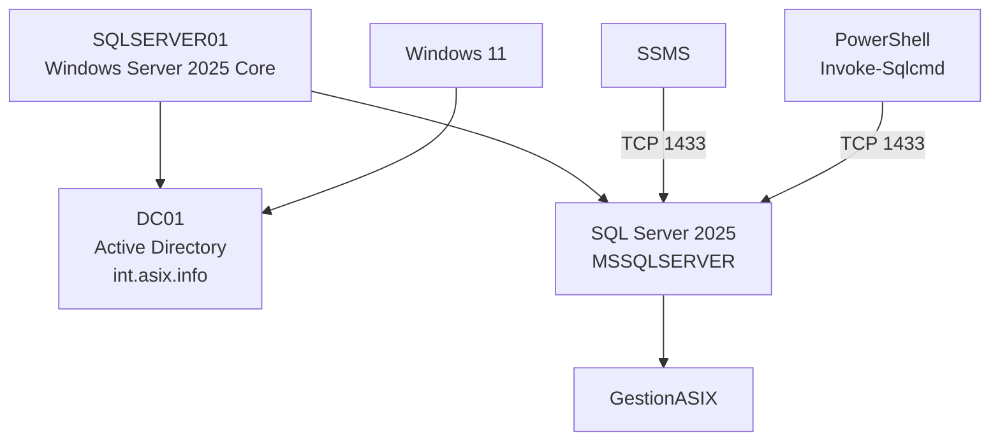

# Administración de SQL Server 2025

Una vez instalado y configurado **SQL Server 2025** en `SQLSERVER01`, la administración cotidiana se realizará de forma remota desde un equipo cliente del dominio `int.asix.info`.

En estos apuntes se utilizarán dos herramientas principales:

- **SQL Server Management Studio (SSMS)** para la administración gráfica.
- **PowerShell**, mediante el módulo `SqlServer` y el cmdlet `Invoke-Sqlcmd`, para la administración y automatización desde línea de comandos.

Para las pruebas se utilizará la base de datos didáctica **`GestionASIX`**, basada en el mismo escenario empleado en los apuntes de Active Directory.

---

## 1. Administración con SQL Server Management Studio

**SQL Server Management Studio (SSMS)** se instalará en un equipo Windows 11 de administración, no en Windows Server Core.

Los parámetros básicos de conexión serán:

```text
Server type:     Database Engine
Server name:     SQLSERVER01
Authentication:  Windows Authentication
```

También puede utilizarse:

```text
SQLSERVER01.int.asix.info
```

Al utilizar **Windows Authentication**, SQL Server recibe la identidad del usuario de dominio que está ejecutando SSMS.

---
## 2. Administración mediante PowerShell

Además de SSMS, SQL Server puede administrarse mediante PowerShell.

En el equipo cliente instalaremos el módulo oficial:

```powershell
Install-Module SqlServer
```

Comprobamos su instalación:

```powershell
Get-Module SqlServer -ListAvailable
```

y la existencia de `Invoke-Sqlcmd`:

```powershell
Get-Command Invoke-Sqlcmd
```

---

### 2.1. Primera consulta

```powershell
Invoke-Sqlcmd `
    -ServerInstance "SQLSERVER01" `
    -Query "SELECT @@SERVERNAME AS Servidor;"
```

Resultado esperado:

```text
Servidor
--------
SQLSERVER01
```

---

### 2.2. Comprobar la identidad utilizada

```powershell
Invoke-Sqlcmd `
    -ServerInstance "SQLSERVER01" `
    -Query "SELECT SYSTEM_USER AS Usuario;"
```

El resultado mostrará una identidad de Windows, por ejemplo:

```text
ASIX\jrsoria
```

Esto confirma que la conexión está utilizando **Windows Authentication**.

---

### 2.3. Consultar la versión

```powershell
Invoke-Sqlcmd `
    -ServerInstance "SQLSERVER01" `
    -Query "SELECT @@VERSION AS VersionSQL;"
```

---

## 3. Base de datos de ejemplo: `GestionASIX`

Para realizar pruebas utilizaremos una base de datos didáctica relacionada con el mismo escenario empleado en los apuntes de Active Directory.

La estructura organizativa de referencia del dominio `int.asix.info` contiene, entre otras, las siguientes unidades organizativas:

```text
int.asix.info
│
├── Alumnado
│   └── ASIX
│       ├── asix1alu
│       └── asix2alu
│
├── Profesorado
│
└── Aulas
    ├── aula01
    └── aula02
```

En Active Directory aparecen también objetos de ejemplo como:

```text
Usuarios:
    agarcia
    jrsoria
    lperez

Equipos:
    PC-AULA01-01
    PC-AULA01-02
    PC-AULA02-01
    PC-AULA02-02
```

Utilizaremos parte de esta información para realizar unas primeras operaciones SQL.

!!! note "Active Directory y SQL Server son sistemas distintos"
    Los ejemplos reutilizan los mismos nombres para mantener un escenario coherente, pero **no existe una sincronización automática** entre los objetos de Active Directory y las tablas de SQL Server.

---

## 4. Crear la base de datos

Desde PowerShell:

```powershell
Invoke-Sqlcmd `
    -ServerInstance "SQLSERVER01" `
    -Query "CREATE DATABASE GestionASIX;"
```

Comprobamos las bases existentes:

```powershell
Invoke-Sqlcmd `
    -ServerInstance "SQLSERVER01" `
    -Query "SELECT name FROM sys.databases;"
```

Entre ellas deberá aparecer:

```text
GestionASIX
```

---

## 5. Crear tablas de ejemplo

Vamos a crear tres tablas sencillas:

```text
GestionASIX
│
├── Cursos
├── Personas
└── Equipos
```

### 5.1. Tabla `Cursos`

```powershell
Invoke-Sqlcmd `
    -ServerInstance "SQLSERVER01" `
    -Database "GestionASIX" `
    -Query @"
CREATE TABLE Cursos (
    IdCurso INT PRIMARY KEY,
    Nombre NVARCHAR(50) NOT NULL
);
"@
```

Insertamos dos cursos:

```powershell
Invoke-Sqlcmd `
    -ServerInstance "SQLSERVER01" `
    -Database "GestionASIX" `
    -Query @"
INSERT INTO Cursos (IdCurso, Nombre)
VALUES
    (1, 'ASIX1'),
    (2, 'ASIX2');
"@
```

---

### 5.2. Tabla `Personas`

```powershell
Invoke-Sqlcmd `
    -ServerInstance "SQLSERVER01" `
    -Database "GestionASIX" `
    -Query @"
CREATE TABLE Personas (
    IdPersona INT PRIMARY KEY,
    Nombre NVARCHAR(100) NOT NULL,
    UsuarioDominio NVARCHAR(50) NOT NULL,
    Tipo NVARCHAR(20) NOT NULL,
    IdCurso INT NULL,
    CONSTRAINT FK_Personas_Cursos
        FOREIGN KEY (IdCurso)
        REFERENCES Cursos(IdCurso)
);
"@
```

Insertamos algunos usuarios conocidos del ejemplo de Active Directory:

```powershell
Invoke-Sqlcmd `
    -ServerInstance "SQLSERVER01" `
    -Database "GestionASIX" `
    -Query @"
INSERT INTO Personas
    (IdPersona, Nombre, UsuarioDominio, Tipo, IdCurso)
VALUES
    (1, 'Ana Garcia', 'agarcia', 'Profesorado', NULL),
    (2, 'José Ramón Soria', 'jrsoria', 'Profesorado', NULL),
    (3, 'Luis Perez', 'lperez', 'Alumnado', 1);
"@
```

---

### 5.3. Tabla `Equipos`

```powershell
Invoke-Sqlcmd `
    -ServerInstance "SQLSERVER01" `
    -Database "GestionASIX" `
    -Query @"
CREATE TABLE Equipos (
    IdEquipo INT PRIMARY KEY,
    NombreEquipo NVARCHAR(50) NOT NULL,
    Aula NVARCHAR(20) NOT NULL
);
"@
```

Insertamos los equipos de ejemplo:

```powershell
Invoke-Sqlcmd `
    -ServerInstance "SQLSERVER01" `
    -Database "GestionASIX" `
    -Query @"
INSERT INTO Equipos
    (IdEquipo, NombreEquipo, Aula)
VALUES
    (1, 'PC-AULA01-01', 'aula01'),
    (2, 'PC-AULA01-02', 'aula01'),
    (3, 'PC-AULA02-01', 'aula02'),
    (4, 'PC-AULA02-02', 'aula02');
"@
```

---

## 6. Consultar los datos

### 6.1. Mostrar todos los usuarios

```powershell
Invoke-Sqlcmd `
    -ServerInstance "SQLSERVER01" `
    -Database "GestionASIX" `
    -Query "SELECT * FROM Personas;"
```

---

### 6.2. Mostrar solamente el profesorado

```powershell
Invoke-Sqlcmd `
    -ServerInstance "SQLSERVER01" `
    -Database "GestionASIX" `
    -Query @"
SELECT Nombre, UsuarioDominio
FROM Personas
WHERE Tipo = 'Profesorado';
"@
```

---

### 6.3. Mostrar los equipos de `aula01`

```powershell
Invoke-Sqlcmd `
    -ServerInstance "SQLSERVER01" `
    -Database "GestionASIX" `
    -Query @"
SELECT NombreEquipo
FROM Equipos
WHERE Aula = 'aula01';
"@
```

---

### 6.4. Relacionar alumnado y curso

```powershell
Invoke-Sqlcmd `
    -ServerInstance "SQLSERVER01" `
    -Database "GestionASIX" `
    -Query @"
SELECT
    Personas.Nombre,
    Personas.UsuarioDominio,
    Cursos.Nombre AS Curso
FROM Personas
INNER JOIN Cursos
    ON Personas.IdCurso = Cursos.IdCurso;
"@
```

Con estas operaciones básicas hemos realizado desde PowerShell:

```text
Crear base de datos
        ↓
Crear tablas
        ↓
Insertar información
        ↓
Consultar datos
```

---

## 7. Comprobaciones finales

Antes de considerar finalizada la instalación debemos comprobar:

### En `SQLSERVER01`

```powershell
Get-Service MSSQLSERVER
```

```powershell
Get-Process sqlservr
```

```powershell
Get-NetTCPConnection -LocalPort 1433 -State Listen
```

```powershell
Get-NetFirewallRule -DisplayName "SQL Server - TCP 1433"
```

### Desde el cliente

```powershell
Resolve-DnsName SQLSERVER01.int.asix.info
```

```powershell
Test-NetConnection SQLSERVER01 -Port 1433
```

```powershell
Invoke-Sqlcmd `
    -ServerInstance SQLSERVER01 `
    -Query "SELECT @@SERVERNAME AS Servidor, SYSTEM_USER AS Usuario;"
```

Si las comprobaciones anteriores son correctas, disponemos de un servidor SQL Server funcional y accesible desde la red del dominio.

---

## 8. Resolución básica de problemas

### No se resuelve `SQLSERVER01`

Comprobar:

```powershell
Resolve-DnsName SQLSERVER01
```

y revisar la configuración DNS:

```powershell
Get-DnsClientServerAddress
```

---

### `Test-NetConnection` devuelve `False`

Comprobar primero el servicio:

```powershell
Get-Service MSSQLSERVER
```

Después:

```powershell
Get-NetTCPConnection -LocalPort 1433 -State Listen
```

y finalmente la regla de firewall:

```powershell
Get-NetFirewallRule -DisplayName "SQL Server - TCP 1433"
```

---

### `Invoke-Sqlcmd` no existe

Comprobar:

```powershell
Get-Module SqlServer -ListAvailable
```

Si no está instalado:

```powershell
Install-Module SqlServer
```

---

### SQL Server rechaza la autenticación

Comprobar la identidad con la que se ejecuta PowerShell:

```powershell
whoami
```

La cuenta debe disponer de permisos en SQL Server.

Durante la instalación se añadió como administrador la cuenta indicada mediante:

```text
/SQLSYSADMINACCOUNTS
```

---

### SQL Server funciona localmente pero no remotamente

Revisar, en este orden:

```text
1. DNS
2. Conectividad IP
3. Servicio MSSQLSERVER
4. TCP/IP habilitado
5. Puerto TCP 1433 en escucha
6. Windows Defender Firewall
7. Permisos de autenticación
```

---

## 9. Resultado de la configuración

Al finalizar tendremos:



El servidor queda preparado para alojar bases de datos utilizadas por los distintos servicios y scripts de la infraestructura.

---

## 📚 Referencias

!!! info "Documentación oficial"
    * **Microsoft Learn — SQL Server Management Studio (SSMS):** [https://learn.microsoft.com/es-es/ssms/sql-server-management-studio-ssms](https://learn.microsoft.com/es-es/ssms/sql-server-management-studio-ssms)
    * **Microsoft Learn — SQL Server PowerShell:** [https://learn.microsoft.com/es-es/powershell/sql-server/sql-server-powershell](https://learn.microsoft.com/es-es/powershell/sql-server/sql-server-powershell)
    * **Referencia del cmdlet `Invoke-Sqlcmd`:** [https://learn.microsoft.com/es-es/powershell/module/sqlserver/invoke-sqlcmd](https://learn.microsoft.com/es-es/powershell/module/sqlserver/invoke-sqlcmd)
    * **Creación de bases de datos en SQL Server:** [https://learn.microsoft.com/es-es/sql/relational-databases/databases/create-a-database](https://learn.microsoft.com/es-es/sql/relational-databases/databases/create-a-database)
    * **Sentencia `CREATE TABLE` (Transact-SQL):** [https://learn.microsoft.com/es-es/sql/t-sql/statements/create-table-transact-sql](https://learn.microsoft.com/es-es/sql/t-sql/statements/create-table-transact-sql)
    * **Sentencias `INSERT` y `SELECT` (Transact-SQL):** [https://learn.microsoft.com/es-es/sql/t-sql/queries/select-transact-sql](https://learn.microsoft.com/es-es/sql/t-sql/queries/select-transact-sql)
    * **Autenticación en SQL Server y modos de seguridad:** [https://learn.microsoft.com/es-es/sql/relational-databases/security/choose-an-authentication-mode](https://learn.microsoft.com/es-es/sql/relational-databases/security/choose-an-authentication-mode)
    * **Estructura Organizativa en Active Directory:** [https://joseramoniesmz.github.io/ASO/apuntes/active-directory/estructura-ad/](https://joseramoniesmz.github.io/ASO/apuntes/active-directory/estructura-ad/)

!!! info "Autoría y contexto educativo"
    * **Docente y elaboración didáctica:** José Ramón Soria Nieto, Departamento de Informática del **IES Marcos Zaragoza**.
    * Material elaborado para el módulo **Administración de Sistemas Operativos** del ciclo de **Administración de Sistemas Informáticos en Red**.
    * Contenido estructurado con apoyo de inteligencia artificial generativa y revisado tomando como referencia la documentación oficial de Microsoft.

!!! abstract "Soporte Institucional y Fondo Social Europeo"
    * **Órgano Regulador:** Generalitat Valenciana — Conselleria d'Educació, Cultura i Esport.
    * **Acreditación de Financiación:** Proyecto tecnológico cofinanciado por la **Unión Europea** a través del **Fondo Social Europeo (FSE)**.
    * *«El FSE invierte en tu futuro»* — Acciones destinadas a la digitalización avanzada, el despliegue de infraestructuras críticas en las aulas y la formación técnica especializada para entornos laborales de Formación Profesional.

