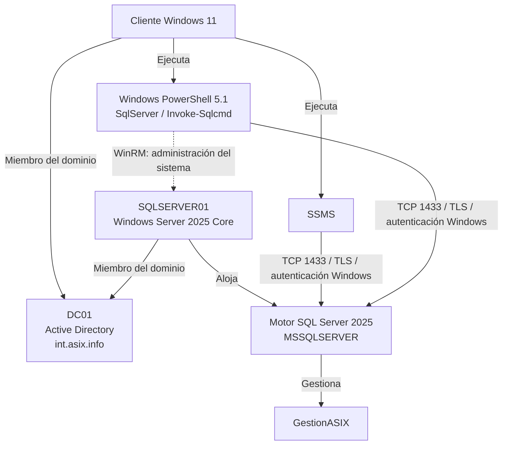

# Administración de SQL Server 2025

Una vez instalado y configurado **SQL Server 2025** en `SQLSERVER01`, administraremos el servicio desde un equipo Windows 11 del dominio `int.asix.info`.

Utilizaremos dos herramientas:

- **SQL Server Management Studio (SSMS)** para trabajar con el entorno gráfico y ejecutar instrucciones Transact-SQL.
- **Windows PowerShell 5.1**, con el módulo `SqlServer`, para realizar consultas y automatizar operaciones.

Todas las conexiones utilizarán **autenticación Windows**. La identidad será la de la cuenta que ejecute la herramienta o el script; SQL Server comprobará sus permisos. No necesitamos guardar contraseñas de acceso a la base de datos en los scripts.

La base de datos didáctica será **`GestionASIX`**. Contendrá información de cursos, personas y equipos, además de un pequeño registro de préstamos de material.

## 1. Requisitos y entorno de trabajo

Antes de comenzar:

- `SQLSERVER01` está unido al dominio y tiene instalado el motor de SQL Server.
- El cliente utiliza el DNS del dominio y resuelve `SQLSERVER01.int.asix.info`.
- En este laboratorio se ha configurado una **instancia predeterminada**, con servicio `MSSQLSERVER`, TCP/IP habilitado y puerto TCP estático **1433**.
- La cuenta utilizada tiene los permisos necesarios para cada operación.
- Para las comprobaciones del sistema operativo por WinRM, la administración remota está habilitada y la cuenta tiene autorización para utilizarla.

!!! note "Identidad y permisos"
    Pertenecer al dominio permite utilizar una identidad de Windows, pero **no concede automáticamente acceso a SQL Server**. Tampoco convierte a un administrador del dominio en administrador del motor SQL.

    En este entorno, las cuentas que administran el motor de SQL Server en `SQLSERVER01` pertenecen al grupo de dominio **`ASIX\GG_SQLAdmins`**, autorizado durante la instalación mediante `/SQLSYSADMINACCOUNTS`. Utiliza una cuenta de ese grupo para preparar el entorno y conceder permisos limitados a otras cuentas o grupos.

### 1.1. Comprobar la consola

En el cliente, abre **Windows PowerShell** (`powershell.exe`) y ejecuta:

```powershell
$PSVersionTable | Select-Object PSVersion, PSEdition
whoami
```

La versión será `5.1...` y la edición, `Desktop`.

!!! info "Windows PowerShell y PowerShell 7"
    Estos ejemplos se plantean para Windows PowerShell 5.1 por su integración con el entorno Windows del laboratorio. PowerShell 7 también permite administrar Windows Server y puede coexistir con 5.1; la elección depende de los módulos y scripts utilizados.

### 1.2. Dónde se ejecuta cada herramienta

SSMS y el módulo `SqlServer` se instalan en el **cliente de administración**. Una consulta enviada con `Invoke-Sqlcmd` se ejecuta en el motor SQL remoto, aunque la consola se encuentre en el cliente.

Los comandos como `Get-Service` o `Get-NetTCPConnection` consultan el sistema donde se ejecutan. Para comprobar el servidor desde el cliente utilizaremos `Invoke-Command` cuando corresponda.

## 2. Conexión con SQL Server Management Studio

Instala **SSMS en Windows 11**. En este escenario no lo instalaremos en Windows Server Core.

Utiliza estos parámetros de conexión:

```text
Server type:     Database Engine
Server name:     tcp:SQLSERVER01.int.asix.info,1433
Authentication:  Windows Authentication
```

El prefijo `tcp:` y el puerto permiten indicar explícitamente el transporte utilizado. El puerto 1433 es el configurado en este laboratorio; otras instalaciones pueden utilizar uno diferente.

### 2.1. Cifrado y certificado del servidor

La conexión debe utilizar cifrado. En una configuración con un certificado válido:

- El cliente confía en la entidad que lo ha emitido.
- El nombre DNS empleado para conectar figura en el certificado.
- La opción **Trust server certificate / Confiar en el certificado del servidor** permanece desactivada.

Si el laboratorio utiliza un certificado autofirmado o una cadena que el cliente no reconoce, puede ser necesario activar temporalmente esa opción. La conexión seguirá cifrada, pero **no se validará el certificado del servidor**. La solución para un entorno de producción es configurar un certificado válido y confiable.

### 2.2. Ejecutar una primera consulta

1. Conecta con la cuenta de dominio autorizada.
2. Abre **New Query / Nueva consulta**.
3. Selecciona `master` en el selector de base de datos.
4. Ejecuta con **F5**:

```sql
SELECT
    @@SERVERNAME AS Servidor,
    ORIGINAL_LOGIN() AS InicioSesion,
    SYSTEM_USER AS ContextoActual,
    DB_NAME() AS BaseActual;
```

Revisa las pestañas **Results / Resultados** y **Messages / Mensajes**. La segunda muestra errores como falta de permisos, objetos inexistentes o datos incompatibles con una columna.

Cuando creemos `GestionASIX`, selecciónala antes de ejecutar consultas sobre sus tablas. El selector de base de datos de SSMS cumple una función equivalente al parámetro `-Database` de `Invoke-Sqlcmd`.

## 3. Preparar Windows PowerShell

### 3.1. Instalar y cargar el módulo

En el cliente, con la cuenta que vaya a trabajar:

```powershell
Install-Module -Name SqlServer -Scope CurrentUser -Repository PSGallery
Import-Module SqlServer -MinimumVersion 22.0.0 -ErrorAction Stop

Get-Module SqlServer | Select-Object Name, Version
Get-Command Invoke-Sqlcmd
```

`-Scope CurrentUser` instala el módulo para la cuenta actual sin requerir una instalación para todos los usuarios. Si PowerShell solicita instalar el proveedor NuGet o confirmar el repositorio, revisa el origen antes de aceptarlo.

Estos apuntes utilizan los parámetros de cifrado disponibles en la versión 22 o posterior del módulo.

!!! note "Instalación por usuario"
    Que el módulo esté disponible para una cuenta no implica que lo esté para otra. Si cambia la identidad que ejecuta un script, comprueba también su acceso al módulo.

### 3.2. Definir la conexión

Ejecuta este bloque al comenzar cada nueva consola:

```powershell
$ConexionSql = @{
    ServerInstance = 'tcp:SQLSERVER01.int.asix.info,1433'
    Encrypt        = 'Mandatory'
    ErrorAction    = 'Stop'
    AbortOnError   = $true
}

$BaseDatos = 'GestionASIX'
```

`$ConexionSql` es una tabla de parámetros. La expresión `@ConexionSql` permite pasarlos a `Invoke-Sqlcmd` sin repetirlos en todos los ejemplos. Esta técnica se llama **splatting**.

No se indican usuario ni contraseña: el cmdlet utiliza la **identidad Windows del proceso**.

Si todavía no hay un certificado confiable en el laboratorio, añade:

```powershell
# Solo para el laboratorio cuando el certificado no puede validarse.
$ConexionSql.TrustServerCertificate = $true
```

Cuando la validación del certificado ya esté configurada, elimina esa excepción:

```powershell
$ConexionSql.Remove('TrustServerCertificate')
```

### 3.3. Probar acceso, identidad y versión

```powershell
$Consulta = @'
SELECT
    @@SERVERNAME AS Servidor,
    ORIGINAL_LOGIN() AS InicioSesion,
    SYSTEM_USER AS ContextoActual,
    DB_NAME() AS BaseActual;
'@

Invoke-Sqlcmd @ConexionSql -Database master -Query $Consulta
Invoke-Sqlcmd @ConexionSql -Database master -Query 'SELECT @@VERSION AS VersionSQL;'
```

La identidad tendrá el formato del nombre NetBIOS del dominio y la cuenta, por ejemplo `ASIX\jrsoria` si el nombre NetBIOS es `ASIX`. No deduzcas ese prefijo únicamente a partir del nombre DNS del dominio: compruébalo con `whoami`.

`ORIGINAL_LOGIN()` identifica el inicio de sesión original y `SYSTEM_USER`, el contexto de seguridad actual. En una sesión normal sin suplantación coincidirán.

---

#### 🎬 Vídeo demostración: Herramientas cliente para SQL Server (SSMS y SqlServer)

Vídeo complementario con la demostración práctica del acceso y conexión a SQL Server utilizando herramientas cliente como SQL Server Management Studio (SSMS) y el módulo de PowerShell `SqlServer`.

<div class="video-embed">
  <iframe 
    src="https://www.youtube.com/embed/ib_x6M20LY0" 
    title="SQL Server - Herramientas cliente: SSMS y módulo SqlServer" 
    allow="accelerometer; autoplay; clipboard-write; encrypted-media; gyroscope; picture-in-picture; web-share" 
    allowfullscreen>
  </iframe>
</div>

!!! info "Ver en YouTube"
    Si prefieres abrir el tutorial directamente en la plataforma o guardarlo en tus listas de reproducción, puedes acceder a través del siguiente enlace:  
    **[▶ Abrir vídeo directamente en YouTube](https://youtu.be/ib_x6M20LY0)**

---

## 4. Crear la base de datos didáctica

La preparación de la base de datos y sus tablas se realiza con una cuenta de dominio perteneciente a **`ASIX\GG_SQLAdmins`**, el grupo autorizado para administrar el motor de SQL Server en `SQLSERVER01`.

Reutilizaremos nombres del escenario de Active Directory, pero las tablas son independientes del directorio: insertar una persona no crea una cuenta de dominio y registrar un equipo no lo une al dominio.

```powershell
$Consulta = @'
IF DB_ID(N'GestionASIX') IS NULL
BEGIN
    CREATE DATABASE GestionASIX;
END;
'@

Invoke-Sqlcmd @ConexionSql -Database master -Query $Consulta

Invoke-Sqlcmd @ConexionSql -Database master -Query @'
SELECT name, state_desc
FROM sys.databases
WHERE name = N'GestionASIX';
'@
```

La comprobación evita intentar crear otra vez una base que ya existe. No elimina ni reinicializa sus datos.

## 5. Crear las tablas

Utilizaremos el esquema `dbo` para indicar de forma explícita dónde se encuentran los objetos.

```powershell
$Consulta = @'
IF OBJECT_ID(N'dbo.Cursos', N'U') IS NULL
BEGIN
    CREATE TABLE dbo.Cursos (
        IdCurso INT NOT NULL CONSTRAINT PK_Cursos PRIMARY KEY,
        Nombre NVARCHAR(50) NOT NULL
    );
END;

IF OBJECT_ID(N'dbo.Personas', N'U') IS NULL
BEGIN
    CREATE TABLE dbo.Personas (
        IdPersona INT NOT NULL CONSTRAINT PK_Personas PRIMARY KEY,
        Nombre NVARCHAR(100) NOT NULL,
        UsuarioDominio NVARCHAR(50) NOT NULL,
        Tipo NVARCHAR(20) NOT NULL,
        IdCurso INT NULL,
        CONSTRAINT CK_Personas_Tipo
            CHECK (Tipo IN (N'Profesorado', N'Alumnado')),
        CONSTRAINT FK_Personas_Cursos
            FOREIGN KEY (IdCurso) REFERENCES dbo.Cursos(IdCurso)
    );
END;

IF OBJECT_ID(N'dbo.Equipos', N'U') IS NULL
BEGIN
    CREATE TABLE dbo.Equipos (
        IdEquipo INT NOT NULL CONSTRAINT PK_Equipos PRIMARY KEY,
        NombreEquipo NVARCHAR(50) NOT NULL,
        Aula NVARCHAR(20) NOT NULL
    );
END;

IF OBJECT_ID(N'dbo.Prestamos', N'U') IS NULL
BEGIN
    CREATE TABLE dbo.Prestamos (
        IdPrestamo INT IDENTITY(1,1) NOT NULL
            CONSTRAINT PK_Prestamos PRIMARY KEY,
        Material NVARCHAR(100) NOT NULL,
        Cantidad INT NOT NULL CONSTRAINT CK_Prestamos_Cantidad CHECK (Cantidad > 0),
        FechaPrestamo DATETIME2(0) NOT NULL,
        ImporteDeposito DECIMAL(8,2) NOT NULL
            CONSTRAINT CK_Prestamos_Importe CHECK (ImporteDeposito >= 0),
        Observaciones NVARCHAR(200) NULL
    );
END;
'@

Invoke-Sqlcmd @ConexionSql -Database $BaseDatos -Query $Consulta
```

Conceptos empleados:

- `PRIMARY KEY`: identifica cada fila sin duplicados.
- `FOREIGN KEY`: exige que el curso indicado en una persona exista.
- `NOT NULL`: obliga a proporcionar un valor.
- `NULL`: representa la ausencia de un valor; no es una cadena vacía ni el número cero.
- `NVARCHAR`: almacena texto Unicode. En los literales SQL se utiliza el prefijo `N`, por ejemplo `N'José Ramón'`.
- `IDENTITY`: genera automáticamente el identificador de cada préstamo.
- `DATETIME2(0)`: almacena fecha y hora con precisión de segundos.
- `DECIMAL(8,2)`: almacena un valor decimal exacto con ocho dígitos totales, dos de ellos decimales.
- `CHECK`: limita los valores aceptados.

!!! note "Repetir no equivale a actualizar el esquema"
    Estos bloques crean las tablas si no existen. Si una tabla ya existe con otra estructura, no la modifican. Revisa su definición y planifica el cambio con `ALTER TABLE` cuando sea necesario.

Comprueba los objetos:

```powershell
Invoke-Sqlcmd @ConexionSql -Database $BaseDatos -Query @'
SELECT TABLE_SCHEMA, TABLE_NAME
FROM INFORMATION_SCHEMA.TABLES
WHERE TABLE_TYPE = 'BASE TABLE'
ORDER BY TABLE_SCHEMA, TABLE_NAME;
'@
```

## 6. Insertar datos de ejemplo

Primero insertamos cursos y después las personas que los referencian. Las comprobaciones por identificador permiten repetir esta carga didáctica sin duplicar sus filas.

```powershell
$Consulta = @'
IF NOT EXISTS (SELECT 1 FROM dbo.Cursos WHERE IdCurso = 1)
    INSERT INTO dbo.Cursos (IdCurso, Nombre) VALUES (1, N'ASIX1');

IF NOT EXISTS (SELECT 1 FROM dbo.Cursos WHERE IdCurso = 2)
    INSERT INTO dbo.Cursos (IdCurso, Nombre) VALUES (2, N'ASIX2');

IF NOT EXISTS (SELECT 1 FROM dbo.Personas WHERE IdPersona = 1)
    INSERT INTO dbo.Personas (IdPersona, Nombre, UsuarioDominio, Tipo, IdCurso)
    VALUES (1, N'Ana García', N'agarcia', N'Profesorado', NULL);

IF NOT EXISTS (SELECT 1 FROM dbo.Personas WHERE IdPersona = 2)
    INSERT INTO dbo.Personas (IdPersona, Nombre, UsuarioDominio, Tipo, IdCurso)
    VALUES (2, N'José Ramón Soria', N'jrsoria', N'Profesorado', NULL);

IF NOT EXISTS (SELECT 1 FROM dbo.Personas WHERE IdPersona = 3)
    INSERT INTO dbo.Personas (IdPersona, Nombre, UsuarioDominio, Tipo, IdCurso)
    VALUES (3, N'Luis Pérez', N'lperez', N'Alumnado', 1);

IF NOT EXISTS (SELECT 1 FROM dbo.Equipos WHERE IdEquipo = 1)
    INSERT INTO dbo.Equipos (IdEquipo, NombreEquipo, Aula)
    VALUES (1, N'PC-AULA01-01', N'aula01');

IF NOT EXISTS (SELECT 1 FROM dbo.Equipos WHERE IdEquipo = 2)
    INSERT INTO dbo.Equipos (IdEquipo, NombreEquipo, Aula)
    VALUES (2, N'PC-AULA02-01', N'aula02');
'@

Invoke-Sqlcmd @ConexionSql -Database $BaseDatos -Query $Consulta
```

Si una fila ya existe, se conserva su contenido. Estas comprobaciones no son un mecanismo general para resolver inserciones simultáneas: las restricciones de la base de datos siguen siendo necesarias.

## 7. Consultar y comprobar los datos

### 7.1. Mostrar personas

```powershell
Invoke-Sqlcmd @ConexionSql -Database $BaseDatos -Query @'
SELECT IdPersona, Nombre, UsuarioDominio, Tipo, IdCurso
FROM dbo.Personas
ORDER BY IdPersona;
'@
```

Preferimos indicar las columnas que necesitamos para que la consulta sea clara y no cambie su salida por la incorporación de nuevas columnas.

### 7.2. Filtrar profesorado y equipos

Ejecuta cada consulta por separado para visualizar su resultado:

```powershell
Invoke-Sqlcmd @ConexionSql -Database $BaseDatos -Query @'
SELECT Nombre, UsuarioDominio
FROM dbo.Personas
WHERE Tipo = N'Profesorado';
'@

Invoke-Sqlcmd @ConexionSql -Database $BaseDatos -Query @'
SELECT NombreEquipo, Aula
FROM dbo.Equipos
WHERE Aula = N'aula01';
'@
```

### 7.3. Relacionar alumnado y curso

```powershell
Invoke-Sqlcmd @ConexionSql -Database $BaseDatos -Query @'
SELECT p.Nombre, p.UsuarioDominio, c.Nombre AS Curso
FROM dbo.Personas AS p
INNER JOIN dbo.Cursos AS c ON p.IdCurso = c.IdCurso
WHERE p.Tipo = N'Alumnado';
'@
```

`INNER JOIN` devuelve las filas que encuentran correspondencia en ambas tablas. El profesorado sin curso asignado no aparece en esta relación.

## 8. Autenticación Windows y permisos mínimos

Debemos distinguir tres elementos:

1. **Cuenta o grupo de Active Directory**: identidad gestionada por el dominio.
2. **Inicio de sesión o login de SQL Server**: permite reconocer esa identidad en la instancia.
3. **Usuario de la base de datos**: vincula el login con el acceso y los permisos dentro de una base concreta.

Un login creado con `FROM WINDOWS` utiliza autenticación Windows. La existencia de un login en SQL Server no implica utilizar autenticación SQL.

### 8.1. Autorizar un grupo del dominio

El siguiente ejemplo utiliza el grupo de seguridad didáctico `ASIX\GG_Prestamos`. **Debe existir previamente en Active Directory**, con las cuentas de prueba como miembros. Sustituye `ASIX` si el nombre NetBIOS real del dominio es otro.

`ASIX\GG_Prestamos` es un grupo adicional para este ejemplo de acceso limitado. No sustituye a `ASIX\GG_SQLAdmins`, que mantiene la función de administración del motor.

Ejecuta con una cuenta de dominio perteneciente a **`ASIX\GG_SQLAdmins`**:

```powershell
Invoke-Sqlcmd @ConexionSql -Database master -Query @'
IF NOT EXISTS (
    SELECT 1 FROM sys.server_principals WHERE name = N'ASIX\GG_Prestamos'
)
    CREATE LOGIN [ASIX\GG_Prestamos] FROM WINDOWS;
'@

Invoke-Sqlcmd @ConexionSql -Database $BaseDatos -Query @'
IF NOT EXISTS (
    SELECT 1 FROM sys.database_principals WHERE name = N'ASIX\GG_Prestamos'
)
    CREATE USER [ASIX\GG_Prestamos] FOR LOGIN [ASIX\GG_Prestamos];

GRANT SELECT, INSERT ON OBJECT::dbo.Prestamos TO [ASIX\GG_Prestamos];
'@
```

Los permisos se limitan a consultar e insertar en `dbo.Prestamos`. No se concede `sysadmin`, `db_owner` ni permiso general para modificar todas las tablas.

### 8.2. Comprobar con una cuenta limitada

Abre Windows PowerShell con una cuenta de prueba del grupo y vuelve a preparar `$ConexionSql` y `$BaseDatos`. Si acabas de cambiar su pertenencia al grupo, cierra y vuelve a iniciar su sesión de Windows para renovar el token de seguridad.

```powershell
Invoke-Sqlcmd @ConexionSql -Database $BaseDatos -Query @'
SELECT
    ORIGINAL_LOGIN() AS InicioSesion,
    HAS_PERMS_BY_NAME(N'dbo.Prestamos', N'OBJECT', N'SELECT') AS PuedeConsultar,
    HAS_PERMS_BY_NAME(N'dbo.Prestamos', N'OBJECT', N'INSERT') AS PuedeInsertar,
    HAS_PERMS_BY_NAME(N'dbo.Prestamos', N'OBJECT', N'DELETE') AS PuedeBorrar;
'@
```

En una cuenta de prueba que solo tenga los permisos anteriores, se espera `1`, `1` y `0`. Los permisos efectivos pueden ser mayores si la cuenta pertenece a otros grupos o roles. La cuenta de prueba no debe pertenecer a `ASIX\GG_SQLAdmins` ni disponer de otros permisos administrativos: una cuenta administradora no sirve para verificar una restricción de mínimo privilegio.

## 9. Automatizar operaciones desde Windows PowerShell

### 9.1. Ejecutar instrucciones con control de errores

Una consulta puede guardarse en una variable y ejecutarse dentro de `try/catch`:

```powershell
$Consulta = @'
INSERT INTO dbo.Prestamos
    (Material, Cantidad, FechaPrestamo, ImporteDeposito, Observaciones)
VALUES
    (N'Adaptador HDMI', 1, SYSDATETIME(), 10.50, NULL);
'@

try {
    Invoke-Sqlcmd @ConexionSql -Database $BaseDatos -Query $Consulta
    Write-Host 'Inserción ejecutada correctamente.'
}
catch {
    Write-Error -Message ('No se pudo registrar el préstamo: ' + $_.Exception.Message)
    throw
}
```

`-ErrorAction Stop`, incluido en `$ConexionSql`, convierte los errores no terminantes del cmdlet en errores capturables. `-AbortOnError` detiene la ejecución cuando se producen errores SQL que cumplen sus condiciones; **no revierte por sí solo las instrucciones que ya se hayan confirmado**. Para operaciones que deban completarse juntas se utilizan transacciones.

Este ejemplo inserta un nuevo préstamo cada vez que se ejecuta. Que un script funcione no significa que sea seguro repetirlo sin revisar sus efectos.

Comprueba el resultado:

```powershell
Invoke-Sqlcmd @ConexionSql -Database $BaseDatos -Query @'
SELECT TOP (10)
    IdPrestamo, Material, Cantidad, FechaPrestamo, ImporteDeposito, Observaciones
FROM dbo.Prestamos
ORDER BY IdPrestamo DESC;
'@
```

### 9.2. Introducir valores de variables: tipos y formato

Cuando un script obtiene datos, debe conservar su tipo y trasladarlos correctamente a SQL Server:

- Un número no debe convertirse accidentalmente en texto con una coma decimal.
- Una fecha no debe depender de si el sistema interpreta primero el día o el mes.
- Un apóstrofo en un texto no debe romper la instrucción.
- La ausencia de un dato debe representarse mediante `NULL` cuando la columna lo permita.

Las variables SQLCMD de `Invoke-Sqlcmd -Variable` realizan sustitución de texto: **no equivalen a parámetros SQL tipados**. Para entradas externas o variables de aplicación, utiliza una consulta parametrizada.

### 9.3. Ejemplo de inserción parametrizada

El siguiente bloque complementa `Invoke-Sqlcmd` con el proveedor `System.Data.SqlClient` de .NET Framework, disponible en Windows PowerShell 5.1. Los valores se envían separados del texto SQL y la conexión sigue utilizando autenticación Windows.

```powershell
Add-Type -AssemblyName System.Data

$Material = "Adaptador de vídeo O'Brien"
[int]$Cantidad = 2
[datetime]$FechaPrestamo = Get-Date
[decimal]$ImporteDeposito = 12.50
$Observaciones = $null

$Cadena = New-Object System.Data.SqlClient.SqlConnectionStringBuilder
$Cadena.DataSource = $ConexionSql.ServerInstance
$Cadena.InitialCatalog = $BaseDatos
$Cadena.IntegratedSecurity = $true
$Cadena.Encrypt = $true
$Cadena.TrustServerCertificate = [bool]$ConexionSql.TrustServerCertificate

$Conexion = New-Object System.Data.SqlClient.SqlConnection
$Conexion.ConnectionString = $Cadena.ConnectionString
$Comando = $Conexion.CreateCommand()
$Comando.CommandText = @'
INSERT INTO dbo.Prestamos
    (Material, Cantidad, FechaPrestamo, ImporteDeposito, Observaciones)
VALUES
    (@Material, @Cantidad, @FechaPrestamo, @ImporteDeposito, @Observaciones);
'@

$Parametro = $Comando.Parameters.Add('@Material', [System.Data.SqlDbType]::NVarChar, 100)
$Parametro.Value = $Material
$Parametro = $Comando.Parameters.Add('@Cantidad', [System.Data.SqlDbType]::Int)
$Parametro.Value = $Cantidad
$Parametro = $Comando.Parameters.Add('@FechaPrestamo', [System.Data.SqlDbType]::DateTime2)
$Parametro.Value = $FechaPrestamo
$Parametro = $Comando.Parameters.Add('@ImporteDeposito', [System.Data.SqlDbType]::Decimal)
$Parametro.Precision = 8
$Parametro.Scale = 2
$Parametro.Value = $ImporteDeposito
$Parametro = $Comando.Parameters.Add('@Observaciones', [System.Data.SqlDbType]::NVarChar, 200)
if ($null -eq $Observaciones) {
    $Parametro.Value = [DBNull]::Value
}
else {
    $Parametro.Value = $Observaciones
}

try {
    $Conexion.Open()
    $Filas = $Comando.ExecuteNonQuery()
    Write-Host "Filas insertadas: $Filas"
}
catch {
    Write-Error -Message ('Error al insertar: ' + $_.Exception.Message)
    throw
}
finally {
    $Comando.Dispose()
    $Conexion.Dispose()
}
```

El apóstrofo se conserva sin concatenarlo con la instrucción SQL. La fecha y el decimal se envían como valores tipados y `[DBNull]::Value` representa el nulo de base de datos. `finally` libera los recursos aunque falle la operación.

En proyectos nuevos basados en .NET moderno se utiliza `Microsoft.Data.SqlClient`; aquí se emplea el proveedor integrado para mantener el ejemplo autocontenido en Windows PowerShell 5.1.

### 9.4. Ejecutar un archivo SQL

Guarda, por ejemplo, este contenido en `consultas.sql`:

```sql
SELECT IdPersona, Nombre, UsuarioDominio
FROM dbo.Personas
WHERE Tipo = N'Alumnado'
ORDER BY Nombre;
```

Desde la carpeta donde lo hayas guardado, con una cuenta que tenga permiso para consultar `dbo.Personas`:

```powershell
Invoke-Sqlcmd @ConexionSql -Database $BaseDatos -InputFile '.\consultas.sql'
```

Conserva los archivos `.ps1` y `.sql` con una codificación adecuada para los caracteres españoles. En Windows PowerShell 5.1, **UTF-8 con BOM** evita que los scripts sin marca de codificación se interpreten con una página de códigos distinta.

## 10. Comprobaciones de acceso y administración remota

### 10.1. Desde el cliente: DNS y puerto SQL

```powershell
Resolve-DnsName SQLSERVER01.int.asix.info
Test-NetConnection SQLSERVER01.int.asix.info -Port 1433
```

`TcpTestSucceeded : True` confirma que se puede establecer una conexión TCP a ese puerto. Todavía no demuestra que el certificado sea válido ni que la cuenta tenga acceso a SQL Server.

Después comprueba el motor y la base de datos:

```powershell
Invoke-Sqlcmd @ConexionSql -Database $BaseDatos -Query @'
SELECT @@SERVERNAME AS Servidor, ORIGINAL_LOGIN() AS InicioSesion, DB_NAME() AS BaseActual;
'@
```

### 10.2. Desde el cliente: comprobar el sistema del servidor

Ejecuta con una cuenta autorizada para la administración remota de Windows:

```powershell
Invoke-Command -ComputerName SQLSERVER01.int.asix.info -ScriptBlock {
    Get-Service -Name MSSQLSERVER
    Get-Process -Name sqlservr
    Get-NetTCPConnection -LocalPort 1433 -State Listen
}
```

Comprueba también la regla de firewall configurada durante la instalación:

```powershell
Invoke-Command -ComputerName SQLSERVER01.int.asix.info -ScriptBlock {
    $Regla = Get-NetFirewallRule -DisplayName 'SQL Server - TCP 1433' -ErrorAction Stop
    $Regla | Select-Object DisplayName, Enabled, Direction, Action, Profile
    $Regla | Get-NetFirewallPortFilter | Select-Object Protocol, LocalPort
    $Regla | Get-NetFirewallAddressFilter | Select-Object RemoteAddress
}
```

Revisa que esté habilitada, sea de entrada, permita TCP en el puerto configurado y tenga perfiles y direcciones de origen adecuados. Su mera existencia no demuestra que el firewall permita la conexión: pueden intervenir otras reglas o directivas.

Los permisos de WinRM y los permisos de SQL Server son independientes. Una cuenta puede consultar una tabla y no tener autorización para administrar servicios de Windows.

## 11. Resolución de problemas

### No se resuelve el nombre del servidor

En el cliente:

```powershell
Resolve-DnsName SQLSERVER01.int.asix.info
Get-DnsClientServerAddress -AddressFamily IPv4
```

Comprueba que se utilizan los servidores DNS del dominio y que existe el registro del servidor SQL.

### El puerto no responde

Revisa conectividad IP, servicio `MSSQLSERVER`, TCP/IP habilitado, puerto configurado y firewall. Los comandos para comprobar servicio y escucha deben ejecutarse **en el servidor**, directamente o mediante WinRM.

Si WinRM también falla, diagnostica ese acceso por separado: no utiliza el puerto SQL y su fallo no demuestra que el motor esté detenido.

### No se encuentra `Invoke-Sqlcmd` o no se reconoce `-Encrypt`

```powershell
Get-Module SqlServer -ListAvailable | Select-Object Name, Version, Path
Get-Command Invoke-Sqlcmd -Syntax
```

Comprueba la cuenta, la consola y la versión del módulo. Si es necesario, instala una versión actual y abre una nueva consola para cargarla:

```powershell
Install-Module -Name SqlServer -Scope CurrentUser -Repository PSGallery -Force
```

### La cadena de certificados no es de confianza

Comprueba el certificado configurado en SQL Server, su vigencia y la confianza en la entidad emisora. Si el error indica que el nombre no coincide, comprueba además el nombre DNS utilizado para conectar.

En el laboratorio puede aplicarse la excepción `TrustServerCertificate` descrita antes. No es necesario desactivar el cifrado.

### Se rechaza el inicio de sesión de Windows

Comprueba `whoami`, el login Windows autorizado y los grupos de la cuenta. Para administrar el motor, verifica que la cuenta pertenece a `ASIX\GG_SQLAdmins` y que ese grupo sigue autorizado en SQL Server. Si la conexión funciona con una cuenta de ese grupo y falla con una cuenta de prueba, revisa los permisos de esta última en SQL Server.

Si funciona en una consola interactiva pero falla en otro contexto de ejecución, identifica qué cuenta ejecuta realmente el proceso. No presupongas que una tarea automatizada utiliza tu sesión interactiva.

### La cuenta conecta, pero no puede abrir la base o insertar

Comprueba:

1. El valor de `-Database` y el estado de la base de datos.
2. El usuario de base de datos asociado al login.
3. Los permisos sobre el objeto exacto, incluido su esquema.
4. Los tipos, las longitudes, las claves y las restricciones de las columnas.

Un error de permisos no se resuelve concediendo automáticamente `sysadmin` o `db_owner`.

### Ya existe el objeto o se duplica una clave

Los bloques de creación y carga inicial incluyen comprobaciones para facilitar su repetición. Si utilizas instrucciones independientes, consulta antes los objetos y los datos existentes. No borres la base de datos para ocultar el problema.

### Una consulta SQL falla dentro de una sesión remota

Conectar desde el cliente a un servidor por WinRM y, desde allí, acceder a otro servidor SQL con autenticación Windows puede producir un problema de **segundo salto**: la identidad no se delega automáticamente.

Para estos ejemplos ejecuta SSMS o `Invoke-Sqlcmd` directamente desde el cliente hacia SQL Server. Las comprobaciones del sistema operativo se realizan por WinRM de forma independiente. Si una arquitectura necesita delegación, debe configurarse expresamente.

## 12. Arquitectura de administración



La administración gráfica, la ejecución de consultas y la comprobación del sistema operativo tienen funciones diferentes. Antes de dar una operación por terminada, verifica su resultado con la identidad y los permisos que se utilizarán realmente.

## Referencias

!!! info "Documentación oficial"
    - [SQL Server Management Studio](https://learn.microsoft.com/es-es/ssms/sql-server-management-studio-ssms).
    - [Instalar el módulo de SQL Server para PowerShell](https://learn.microsoft.com/es-es/powershell/sql-server/download-sql-server-ps-module).
    - [Referencia de Invoke-Sqlcmd](https://learn.microsoft.com/es-es/powershell/module/sqlserver/invoke-sqlcmd).
    - [Migración y coexistencia de Windows PowerShell 5.1 y PowerShell 7](https://learn.microsoft.com/es-es/powershell/scripting/whats-new/migrating-from-windows-powershell-51-to-powershell-7).
    - [Autenticación de SQL Server](https://learn.microsoft.com/es-es/sql/relational-databases/security/choose-an-authentication-mode).
    - [Crear un inicio de sesión](https://learn.microsoft.com/es-es/sql/relational-databases/security/authentication-access/create-a-login).
    - [CREATE USER](https://learn.microsoft.com/es-es/sql/t-sql/statements/create-user-transact-sql).
    - [GRANT sobre objetos](https://learn.microsoft.com/es-es/sql/t-sql/statements/grant-object-permissions-transact-sql).
    - [CREATE DATABASE](https://learn.microsoft.com/es-es/sql/t-sql/statements/create-database-transact-sql).
    - [CREATE TABLE](https://learn.microsoft.com/es-es/sql/t-sql/statements/create-table-transact-sql).
    - [Clase SqlCommand de System.Data.SqlClient](https://learn.microsoft.com/es-es/dotnet/api/system.data.sqlclient.sqlcommand).
    - [Segundo salto en la comunicación remota de PowerShell](https://learn.microsoft.com/es-es/powershell/scripting/security/remoting/ps-remoting-second-hop).
    - [Codificación de caracteres en PowerShell](https://learn.microsoft.com/es-es/powershell/module/microsoft.powershell.core/about/about_character_encoding).

!!! info "Autoría y contexto educativo"
    - **Docente y elaboración didáctica:** José Ramón Soria Nieto, Departamento de Informática del **IES Marcos Zaragoza**.
    - Material para el módulo **Administración de Sistemas Operativos** del ciclo de **Administración de Sistemas Informáticos en Red**.
    - Contenido elaborado con apoyo de inteligencia artificial generativa y documentación oficial de Microsoft como referencia técnica.
