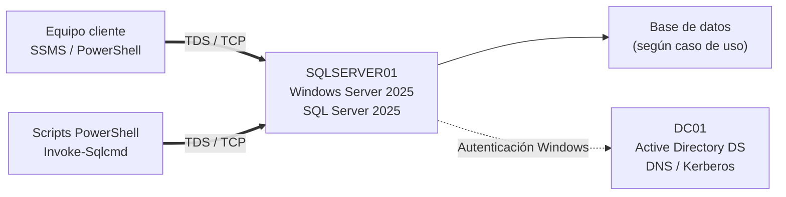
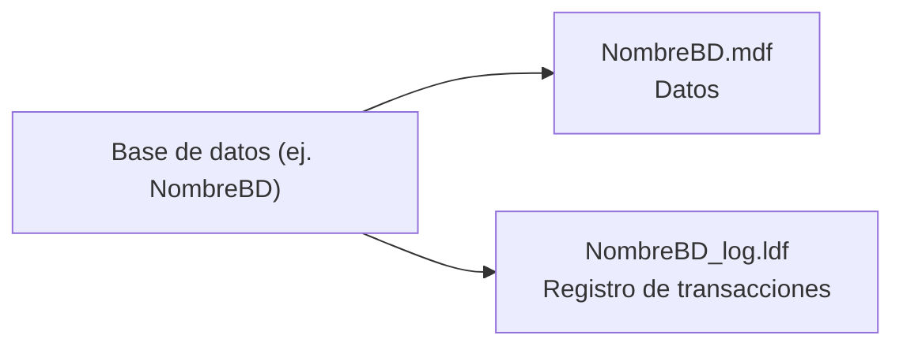
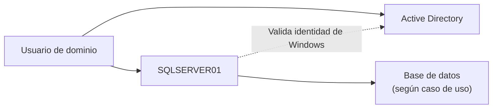
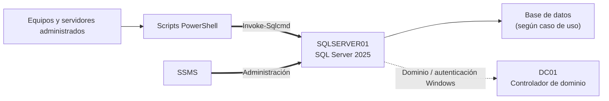

# Fundamentos de Microsoft SQL Server

## 🎯 Finalidad de estos apuntes

En el módulo de **Administración de Sistemas Operativos (ASO)** utilizaremos **Microsoft SQL Server** como un servicio más dentro de una infraestructura empresarial basada en Windows Server, Active Directory y PowerShell.

El objetivo de estos apuntes **no es estudiar en profundidad la administración de bases de datos**, sino conocer los conceptos mínimos necesarios para comprender:

- qué es SQL Server y qué función desempeña dentro de una infraestructura;
- cómo se ejecuta como servicio sobre Windows Server;
- cómo organiza físicamente la información;
- qué son las instancias y cómo se conectan los clientes;
- cómo se integra con Active Directory y la autenticación de Windows;
- qué recursos del sistema consume y por qué conviene controlar su memoria;
- cómo será utilizado posteriormente desde PowerShell mediante `Invoke-Sqlcmd`.

!!! info "SQL Server como tecnología de apoyo"
    SQL Server se utilizará en ASO como parte de la infraestructura necesaria para realizar determinadas tareas de administración y automatización. Estos contenidos tienen carácter introductorio y **no se asocian de forma directa a un Resultado de Aprendizaje concreto del módulo**.

---

## 🏢 1. SQL Server dentro de una infraestructura empresarial

Un servidor puede prestar simultáneamente diferentes servicios a los equipos de una organización: directorio, resolución de nombres, compartición de archivos, aplicaciones web, monitorización o almacenamiento de datos, entre otros.

Un **sistema gestor de bases de datos relacional** o **RDBMS (*Relational Database Management System*)** es un software especializado en almacenar, consultar y modificar información estructurada, garantizando además aspectos como la concurrencia, la seguridad y la consistencia de los datos.

**Microsoft SQL Server** es el RDBMS de Microsoft. Puede instalarse en Windows Server y funcionar como un servicio de infraestructura accesible desde otros equipos de la red.

En nuestro laboratorio, SQL Server se utilizará como repositorio central de datos para servicios y scripts de administración. Se conectará a las bases de datos que sean necesarias según cada caso de uso. El escenario básico será el siguiente:



En este escenario:

- **`DC01`** proporciona el dominio y los servicios de Active Directory.
- **`SQLSERVER01`** es un servidor miembro del dominio donde se ejecutará SQL Server.
- Se conectará a las **bases de datos** requeridas según cada caso de uso (inventario, telemetría, registros, etc.).
- Los clientes podrán administrar el servidor mediante **SQL Server Management Studio (SSMS)**.
- Los scripts PowerShell podrán ejecutar consultas mediante **`Invoke-Sqlcmd`**.
- El acceso se realizará principalmente mediante **autenticación de Windows**, aprovechando las identidades del dominio.

---

## ⚙️ 2. Componentes básicos de SQL Server

### 2.1. El motor de base de datos

El componente principal de SQL Server es el **Database Engine** o motor de base de datos. Es el encargado de:

- procesar consultas SQL;
- leer y escribir datos;
- gestionar transacciones;
- controlar accesos concurrentes;
- utilizar memoria RAM como caché;
- mantener los archivos de las bases de datos;
- aplicar permisos y mecanismos de seguridad.

En Windows, el proceso principal del motor es:

```text
sqlservr.exe
```

Cuando utilizamos una instancia predeterminada, este proceso se ejecuta asociado al servicio de Windows:

```text
SQL Server (MSSQLSERVER)
```

Por tanto, desde el punto de vista del administrador de sistemas, SQL Server debe entenderse también como un **servicio del sistema operativo** que consume CPU, memoria, almacenamiento y recursos de red.

### 2.2. SQLOS y gestión de recursos

Internamente, SQL Server incorpora una capa denominada **SQLOS (SQL Server Operating System)** que ayuda al motor a gestionar de forma eficiente tareas como:

- planificación de trabajos internos;
- gestión de memoria;
- sincronización entre operaciones concurrentes;
- operaciones de entrada/salida.

No necesitamos estudiar su funcionamiento interno en profundidad. Para ASO es suficiente comprender que SQL Server posee mecanismos propios de gestión de recursos y que, por ello, su configuración puede afectar directamente al rendimiento del sistema operativo que lo hospeda.

### 2.3. Buffer Pool

Una parte importante de la memoria utilizada por SQL Server corresponde al **Buffer Pool**.

Cuando SQL Server necesita datos almacenados en disco, intenta mantener las páginas utilizadas recientemente en memoria RAM. Si una consulta vuelve a necesitar esos datos, podrá recuperarlos desde memoria en lugar de realizar nuevamente una operación de disco.

```text
Disco  →  Buffer Pool (RAM)  →  Consulta
```

Este mecanismo mejora notablemente el rendimiento, pero también explica por qué SQL Server puede utilizar grandes cantidades de memoria cuando la carga aumenta.

---

## 💾 3. Cómo almacena SQL Server la información

Una base de datos de SQL Server se materializa en varios archivos almacenados en el sistema de archivos del servidor.

| Tipo de archivo | Extensión habitual | Función |
| :--- | :---: | :--- |
| **Archivo de datos primario** | `.mdf` | Contiene la información principal de la base de datos y sus metadatos. Cada base de datos dispone de un archivo de datos primario. |
| **Archivo de datos secundario** | `.ndf` | Opcional. Permite disponer de archivos de datos adicionales. |
| **Registro de transacciones** | `.ldf` | Registra las modificaciones realizadas sobre la base de datos y permite garantizar la consistencia y recuperación de las transacciones. |

Para cualquier base de datos creada según las necesidades de cada caso de uso, conceptualmente tendremos:



### 3.1. El registro de transacciones

SQL Server utiliza un mecanismo denominado **Write-Ahead Logging (WAL)**. Antes de considerar confirmada una modificación, la información necesaria para recuperarla se registra en el archivo de log.

De forma simplificada:

```text
Modificación
    ↓
Registro de transacciones (.ldf)
    ↓
Confirmación de la transacción
    ↓
Actualización posterior de los archivos de datos (.mdf/.ndf)
```

!!! note "Idea fundamental"
    El archivo `.ldf` no es una copia de la base de datos. Es el **registro de las transacciones** necesarias para proteger la consistencia de la información y participar en los procesos de recuperación.

SQL Server organiza internamente los datos en **páginas y extensiones** para optimizar las operaciones de entrada/salida. Su funcionamiento detallado queda fuera del alcance de estos apuntes.

---

## 🗄️ 4. Bases de datos del sistema

Al instalar SQL Server se crean automáticamente varias bases de datos internas necesarias para el funcionamiento del motor.

```text
SQL Server
│
├── master
├── model
├── msdb
└── tempdb
```

### `master`

Contiene información esencial de la instancia: configuración del servidor, inicios de sesión, información sobre las bases de datos existentes y otros metadatos globales.

Es una base de datos crítica para el arranque del motor.

### `model`

Actúa como **plantilla** para la creación de nuevas bases de datos.

Cuando se crea una base de datos, SQL Server utiliza `model` como punto de partida para inicializarla.

### `msdb`

Almacena información utilizada por distintos componentes de administración, especialmente:

- tareas programadas de SQL Server Agent;
- historial de copias de seguridad;
- alertas y trabajos (*jobs*).

### `tempdb`

Es un espacio de trabajo temporal utilizado por SQL Server para tablas temporales, resultados intermedios y determinadas operaciones internas.

!!! warning "tempdb es temporal"
    `tempdb` se vuelve a crear cada vez que arranca el servicio SQL Server. Nunca debe utilizarse para almacenar información que necesitemos conservar de forma permanente.

---

## 📦 5. Instancias de SQL Server

Una instalación de SQL Server puede contener una o varias **instancias**. Cada instancia funciona de forma independiente y dispone de sus propias bases de datos y configuración.

### 5.1. Instancia predeterminada

La **instancia predeterminada** se identifica directamente mediante el nombre del servidor:

```text
SQLSERVER01
```

Su servicio de Windows se denomina:

```text
MSSQLSERVER
```

Cuando utiliza la configuración TCP habitual, escucha en el puerto:

```text
TCP 1433
```

### 5.2. Instancia con nombre

Una instancia con nombre se identifica utilizando la sintaxis:

```text
SERVIDOR\INSTANCIA
```

Por ejemplo:

```text
SQLSERVER01\DESARROLLO
```

El servicio correspondiente tendría un nombre similar a:

```text
MSSQL$DESARROLLO
```

Las instancias con nombre suelen configurarse inicialmente para utilizar **puertos TCP dinámicos**. El servicio **SQL Server Browser**, que utiliza UDP 1434, puede ayudar a los clientes a localizar el puerto correspondiente a una instancia con nombre.

SQL Server Browser no es imprescindible cuando el cliente conoce directamente el puerto TCP utilizado por la instancia.

!!! tip "Configuración del laboratorio"
    En nuestro laboratorio utilizaremos una **instancia predeterminada**. Esto simplifica las conexiones, la configuración del firewall y el uso posterior desde PowerShell.

---

## 🌐 6. Comunicación entre clientes y SQL Server

Los clientes de SQL Server se comunican con el motor utilizando el protocolo de aplicación **TDS (*Tabular Data Stream*)**.

SQL Server puede utilizar diferentes mecanismos de transporte.

### TCP/IP

Es el mecanismo principal que utilizaremos en el laboratorio para acceder al servidor desde otros equipos de la red.

La instancia predeterminada suele utilizar:

```text
TCP 1433
```

Para que un cliente remoto pueda conectarse será necesario, entre otras cosas:

1. que SQL Server esté iniciado;
2. que el protocolo TCP/IP esté habilitado;
3. que el servidor escuche en el puerto configurado;
4. que el firewall permita la comunicación;
5. que el usuario disponga de permisos en SQL Server.

!!! warning "TCP/IP no implica cifrado por sí mismo"
    TCP/IP proporciona el transporte de las comunicaciones. Cuando se requiera proteger el contenido de la conexión deberán utilizarse los mecanismos de cifrado y certificados soportados por SQL Server.

### Shared Memory

Se utiliza cuando cliente y servidor SQL se encuentran en el mismo sistema operativo. No utiliza la interfaz de red.

### Named Pipes

Es un mecanismo de comunicación que puede utilizarse en determinados escenarios, aunque en nuestro laboratorio priorizaremos **TCP/IP**.

---

## 🔐 7. SQL Server y Active Directory

Cuando SQL Server se encuentra integrado en un dominio Windows, puede utilizar **autenticación de Windows**.

Esto permite que SQL Server identifique usuarios y grupos procedentes de Active Directory, evitando crear necesariamente credenciales independientes para cada usuario dentro del propio servidor SQL.

Por ejemplo, un usuario que ha iniciado sesión en el dominio puede conectarse utilizando su identidad de Windows:

```text
EMPRESA\usuario
```

La autenticación y la autorización son conceptos diferentes:

- **Autenticación:** determina quién es el usuario.
- **Autorización:** determina qué puede hacer ese usuario dentro de SQL Server y de cada base de datos.

En nuestro entorno priorizaremos la **autenticación de Windows**.



Esta integración será especialmente útil cuando los scripts PowerShell se ejecuten utilizando cuentas autorizadas del dominio.

---

## ⚖️ 8. Ediciones de SQL Server 2025

Microsoft distribuye diferentes ediciones de SQL Server según el tipo de uso.

| Edición | Uso principal | Características relevantes |
| :--- | :--- | :--- |
| **Enterprise** | Grandes entornos de producción y cargas críticas. | Funcionalidad completa y límites de escalabilidad dependientes principalmente del sistema operativo y del licenciamiento. |
| **Standard** | Servidores de producción de propósito general. | Hasta el menor valor entre 4 sockets o 32 núcleos y hasta 256 GB de Buffer Pool por instancia. |
| **Enterprise Developer** | Desarrollo, pruebas y formación. | Incluye las funcionalidades de Enterprise, pero **no está licenciada para producción**. |
| **Standard Developer** | Desarrollo y pruebas orientadas a entornos Standard. | Incluye las funcionalidades de Standard, sin licencia para producción. |
| **Express** | Aplicaciones pequeñas, aprendizaje y escenarios ligeros. | Hasta el menor valor entre 1 socket o 4 núcleos, 1.410 MB de Buffer Pool y 50 GB por base de datos. |

!!! success "Edición elegida para el laboratorio"
    Utilizaremos **SQL Server 2025 Standard Developer Edition**, ya que ofrece las funcionalidades de Standard sin coste de licencia para desarrollo, pruebas y formación.

Esta edición permite utilizar, entre otros componentes, **SQL Server Agent**, que resulta útil para comprender la automatización de tareas y trabajos programados en SQL Server.

!!! warning "No apta para producción"
    Standard Developer Edition puede utilizarse para **desarrollo, pruebas y formación**, pero no para prestar un servicio de producción.

---

## 🧠 9. SQL Server como consumidor de recursos del sistema

Desde el punto de vista de Administración de Sistemas Operativos, SQL Server es un servicio especialmente interesante porque hace un uso intensivo de:

- CPU;
- memoria RAM;
- almacenamiento;
- operaciones de entrada/salida;
- red.

### 9.1. Gestión de memoria

SQL Server administra dinámicamente gran parte de la memoria utilizada por el motor. El **Buffer Pool** intenta conservar en RAM los datos utilizados con frecuencia para reducir los accesos a disco.

Esto significa que un servidor SQL puede mantener una cantidad elevada de memoria asignada aunque en un momento determinado no esté ejecutando consultas intensivas.

Para evitar que SQL Server compita excesivamente con Windows Server y otros procesos, puede configurarse el parámetro:

```text
max server memory (MB)
```

Este parámetro establece un límite para una parte importante de la memoria administrada por el motor.

!!! note "Importante"
    `max server memory` no representa un límite absoluto de toda la memoria que puede consumir el proceso `sqlservr.exe`, pero es el principal parámetro utilizado para evitar que el motor monopolice la memoria disponible.

Microsoft recomienda reservar memoria suficiente para el sistema operativo y otros procesos y configurar `max server memory` de acuerdo con los recursos disponibles y la carga del servidor.

### 9.2. Ejemplo en una máquina virtual de laboratorio

Si una VM dispone de **6 GiB de RAM**, una configuración educativa razonable puede consistir en reservar aproximadamente 2 GiB para Windows Server y establecer inicialmente:

```text
max server memory = 4096 MB
```

No se trata de una regla universal, sino de un valor apropiado para nuestro escenario de laboratorio. En un entorno real habría que dimensionarlo según la memoria instalada, los servicios concurrentes y la carga de trabajo.

---

## 🖥️ 10. Integración en nuestra infraestructura ASO

En nuestras prácticas de ASO utilizaremos SQL Server como servicio de infraestructura centralizado, conectando a las bases de datos que sean necesarias según cada caso de uso (inventario, auditoría, telemetría, gestión de servicios, etc.).

La arquitectura será, de forma simplificada:



Los scripts PowerShell obtendrán información de los sistemas o servicios y ejecutarán instrucciones SQL conectándose a la base de datos correspondiente a cada caso de uso.

Para ello utilizaremos el módulo PowerShell **`SqlServer`**, que proporciona el cmdlet:

```powershell
Invoke-Sqlcmd
```

De forma simplificada, una conexión tendrá una estructura similar a:

```powershell
Invoke-Sqlcmd `
    -ServerInstance "SQLSERVER01" `
    -Database "<NombreBaseDatos>" `
    -Query $query `
    -TrustServerCertificate
```

Donde el parámetro `-Database` especifica la base de datos requerida según el caso de uso a implementar.

La instalación, configuración y pruebas de SQL Server se estudiarán en unos apuntes independientes. En ellos se trabajará de forma práctica:

- creación de la VM en Proxmox VE;
- instalación de Windows Server 2025;
- unión de `SQLSERVER01` al dominio;
- instalación de SQL Server 2025 Standard Developer;
- utilización de una instancia predeterminada;
- configuración de TCP/IP;
- apertura del puerto correspondiente en el firewall;
- autenticación de Windows;
- administración mediante SSMS;
- conexión desde PowerShell con `Invoke-Sqlcmd`.

!!! success "Idea final"
    No necesitamos convertirnos en administradores de bases de datos especializados. Necesitamos entender SQL Server como **un servicio de infraestructura integrado en Windows Server**, accesible por red y utilizable desde PowerShell para conectar a las bases de datos necesarias y gestionar la información según cada caso de uso.

---

## 📚 Referencias

!!! info "Documentación oficial"
    * **Microsoft Learn — SQL Server:** [https://learn.microsoft.com/es-es/sql/sql-server/](https://learn.microsoft.com/es-es/sql/sql-server/)
    * **Ediciones y características admitidas de SQL Server 2025:** [https://learn.microsoft.com/es-es/sql/sql-server/editions-and-components-of-sql-server-2025](https://learn.microsoft.com/es-es/sql/sql-server/editions-and-components-of-sql-server-2025)
    * **Novedades de SQL Server 2025:** [https://learn.microsoft.com/es-es/sql/sql-server/what-s-new-in-sql-server-2025](https://learn.microsoft.com/es-es/sql/sql-server/what-s-new-in-sql-server-2025)
    * **Bases de datos del sistema:** [https://learn.microsoft.com/es-es/sql/relational-databases/databases/system-databases](https://learn.microsoft.com/es-es/sql/relational-databases/databases/system-databases)
    * **Arquitectura y administración del registro de transacciones:** [https://learn.microsoft.com/es-es/sql/relational-databases/sql-server-transaction-log-architecture-and-management-guide](https://learn.microsoft.com/es-es/sql/relational-databases/sql-server-transaction-log-architecture-and-management-guide)
    * **Configuración de memoria del servidor:** [https://learn.microsoft.com/es-es/sql/database-engine/configure-windows/server-memory-server-configuration-options](https://learn.microsoft.com/es-es/sql/database-engine/configure-windows/server-memory-server-configuration-options)
    * **Configuración de puertos TCP:** [https://learn.microsoft.com/es-es/sql/database-engine/configure-windows/configure-a-server-to-listen-on-a-specific-tcp-port](https://learn.microsoft.com/es-es/sql/database-engine/configure-windows/configure-a-server-to-listen-on-a-specific-tcp-port)

!!! info "Autoría y contexto educativo"
    * **Docente y elaboración didáctica:** José Ramón Soria Nieto, Departamento de Informática del **IES Marcos Zaragoza**.
    * Material elaborado para el módulo **Administración de Sistemas Operativos** del ciclo de **Administración de Sistemas Informáticos en Red**.
    * Contenido estructurado con apoyo de inteligencia artificial generativa y revisado tomando como referencia la documentación oficial de Microsoft.

!!! abstract "Soporte Institucional y Fondo Social Europeo"
    * **Órgano Regulador:** Generalitat Valenciana — Conselleria d'Educació, Cultura i Esport.
    * **Acreditación de Financiación:** Proyecto tecnológico cofinanciado por la **Unión Europea** a través del **Fondo Social Europeo (FSE)**.
    * *«El FSE invierte en tu futuro»* — Acciones destinadas a la digitalización avanzada, el despliegue de infraestructuras críticas en las aulas y la formación técnica especializada para entornos laborales de Formación Profesional.
