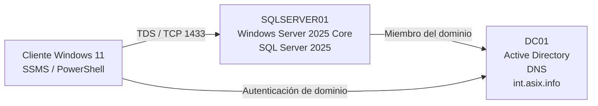

# Instalación y configuración de SQL Server 2025 Standard Developer

## 1. Introducción

En este apartado se realizará la instalación y configuración básica de **Microsoft SQL Server 2025 Standard Developer Edition** sobre un servidor **Windows Server 2025 Core** integrado en el dominio `int.asix.info`.

El objetivo no es estudiar en profundidad la administración de bases de datos, sino preparar un servidor SQL funcional dentro de una infraestructura corporativa y comprobar que puede administrarse de forma remota desde otros equipos del dominio.

La infraestructura de referencia será la siguiente:



!!! info "Escenario de los apuntes"
    Se utilizará el dominio **`int.asix.info`**, coherente con el resto de los apuntes del módulo.  
    Para las pruebas de SQL Server se empleará la base de datos didáctica **`GestionASIX`**, utilizada como ejemplo ilustrativo para las comprobaciones de conectividad y administración.

---

## 2. Preparación de la máquina virtual en Proxmox VE

El servidor `SQLSERVER01` se desplegará como una **máquina virtual en Proxmox VE**, siguiendo el mismo procedimiento general utilizado para crear e instalar la máquina virtual de Windows Server 2025 descrita en los apuntes:

[Instalación de Windows Server 2025 en Proxmox VE](https://joseramoniesmz.github.io/ASO/apuntes/windows-server/instalacion-windows-server/)

Por tanto, no se repetirá aquí todo el procedimiento de creación e instalación del sistema operativo. Se seguirán las mismas fases ya estudiadas:

1. creación de la máquina virtual en Proxmox VE;
2. configuración del hardware virtual;
3. instalación de **Windows Server 2025 Standard en modo Server Core**;
4. carga de los controladores VirtIO;
5. instalación del resto de controladores VirtIO y del **QEMU Guest Agent**;
6. configuración de red y nombre del equipo;
7. instalación de actualizaciones y configuración inicial del servidor.

La principal diferencia será la cantidad de recursos asignados a esta máquina virtual, ya que además del sistema operativo deberá ejecutar el motor de SQL Server.

### 2.1. Configuración mínima recomendada para `SQLSERVER01`

Para el laboratorio se utilizará como mínimo la siguiente configuración:

| Recurso | Configuración |
|---|---|
| Sistema huésped | Microsoft Windows 11/2022/2025 |
| Sistema operativo | Windows Server 2025 Standard Core |
| CPU | **2 vCPU** |
| Tipo de CPU | `x86-64-v2-AES` |
| Memoria RAM | **6 GiB** |
| Disco | **40 GiB** |
| Bus de disco | SCSI |
| Controlador | `VirtIO SCSI single` |
| Caché de disco | `Write back` |
| Discard / TRIM | Activado |
| IO Thread | Activado |
| Tarjeta de red | `VirtIO (paravirtualized)` |
| Bridge | `vmbr0` |
| QEMU Guest Agent | Habilitado |

!!! info "Por qué se asignan 6 GiB de RAM"
    Microsoft establece **1 GB de RAM como mínimo técnico** para las ediciones de SQL Server distintas de Express, pero recomienda **al menos 4 GB** para el propio motor.  
    Como la máquina virtual debe ejecutar simultáneamente **Windows Server 2025 Core y SQL Server 2025**, en el laboratorio se asignarán **6 GiB** para disponer de un margen razonable para el sistema operativo y el motor de base de datos.

!!! info "Por qué se asignan 40 GiB de disco"
    SQL Server requiere al menos **6 GB libres en la unidad del sistema durante la instalación**, aunque el motor de base de datos ocupa bastante menos una vez instalado.  
    Los **40 GiB** proporcionan espacio suficiente para Windows Server, actualizaciones, SQL Server y las pequeñas bases de datos utilizadas en las prácticas del módulo.

!!! note "Configuración mínima del laboratorio, no dimensionamiento de producción"
    Estos valores están pensados para un entorno educativo con bases de datos pequeñas y poca carga. En un servidor SQL de producción, CPU, memoria, almacenamiento y distribución de discos deben dimensionarse según la carga prevista, el volumen de datos y los requisitos de disponibilidad.

### 2.2. Instalación del sistema operativo

La instalación de Windows Server se realizará exactamente con el procedimiento explicado en los apuntes de **Instalación de Windows Server 2025 en Proxmox VE**.

En particular:

- se utilizará **Windows Server 2025 Standard Core**;
- el disco y la interfaz de red utilizarán controladores **VirtIO**;
- se instalará el **QEMU Guest Agent**;
- se configurará una dirección IP adecuada para la red del laboratorio;
- el equipo se denominará **`SQLSERVER01`**;
- su servidor DNS será el controlador de dominio de `int.asix.info`;
- finalmente, `SQLSERVER01` se incorporará al dominio antes de instalar SQL Server.

De este modo, el punto de partida para los apartados siguientes será:

```text
SQLSERVER01
│
├── Windows Server 2025 Standard Core
├── Drivers VirtIO instalados
├── QEMU Guest Agent instalado
├── Red configurada
├── DNS del dominio configurado
└── Miembro de int.asix.info
```

---

## 3. Decisiones de diseño

Para simplificar el laboratorio y mantener un planteamiento profesional se tomarán las siguientes decisiones:

| Elemento | Configuración |
|---|---|
| Sistema operativo | Windows Server 2025 Core |
| Nombre del servidor | `SQLSERVER01` |
| Dominio | `int.asix.info` |
| Edición de SQL Server | Microsoft SQL Server 2025 Standard Developer Edition |
| Componente instalado | Database Engine (`SQLEngine`) |
| Tipo de instancia | Instancia predeterminada |
| Nombre de instancia | `MSSQLSERVER` |
| Autenticación | Windows Authentication |
| Grupo de administración | `ASIX\GG_SQLAdmins` |
| Protocolo de red | TCP/IP |
| Puerto | TCP 1433 |
| Administración gráfica | Desde otro equipo con SSMS |
| Administración PowerShell | Módulo `SqlServer` / `Invoke-Sqlcmd` |

### 3.1. Edición utilizada y licencia

En este laboratorio de **Administración de Sistemas Operativos (ASO)** se utilizará **Microsoft SQL Server 2025 Standard Developer Edition**, una edición **gratuita para desarrollo, pruebas y formación**, siempre en un entorno sin uso de producción.

Es **funcionalmente equivalente a SQL Server 2025 Standard**: incluye sus características y está sujeta a sus límites de capacidad. La variante **Enterprise Developer** incluye, en cambio, las características de Enterprise.

Standard Developer **no tiene caducidad por período de evaluación**, a diferencia de **Evaluation, que caduca a los 180 días**. Esto permite mantener SQL Server durante todo el curso sin esa limitación temporal. La ausencia de caducidad no autoriza su uso en producción.

### 3.2. Límites relevantes de Standard

Según la [documentación oficial de ediciones y características de SQL Server 2025](https://learn.microsoft.com/es-es/sql/sql-server/editions-and-components-of-sql-server-2025?view=sql-server-ver17), a Standard Developer le corresponden los siguientes límites de Standard:

- **CPU del motor por instancia:** el menor de **4 sockets o 32 núcleos**.
- **Memoria del buffer pool por instancia:** hasta **256 GB**.
- **Memoria de la caché de segmentos columnstore por instancia:** hasta **32 GB**.
- **Datos optimizados para memoria de In-Memory OLTP:** hasta **32 GB por base de datos**.
- **Tamaño máximo de una base de datos relacional:** hasta **524 PB**.

!!! note "Límites de la edición y recursos del laboratorio"
    Estos valores son límites máximos de la edición, no recursos que deban asignarse a la máquina virtual. Los **256 GB** corresponden al buffer pool, no a un límite global de memoria de todos los componentes de SQL Server. Para las prácticas se mantiene la configuración de **2 vCPU, 6 GiB de RAM y 40 GiB de disco** indicada en el apartado 2.

### 3.3. SQL Server Agent y adecuación al laboratorio

Standard Developer **dispone de SQL Server Agent**, que permite programar trabajos de administración, como copias de seguridad y tareas de mantenimiento. Su disponibilidad no implica que el servicio esté iniciado ni que existan trabajos configurados.

Esta edición es adecuada para el **laboratorio ASO** porque permite practicar gratuitamente la instalación en Server Core, la autenticación de dominio, la conectividad y la administración remota con las funcionalidades de Standard, sin la caducidad de Evaluation.

!!! warning "No es una edición para producción"
    Standard Developer Edition no debe utilizarse para alojar sistemas de producción reales.

---

## 4. Preparación del servidor

Antes de instalar SQL Server, `SQLSERVER01` debe disponer de una configuración básica correcta de Windows Server.

### 4.1. Comprobar el nombre del equipo

```powershell
hostname
```

El resultado esperado es:

```text
SQLSERVER01
```

Si todavía no se ha establecido el nombre:

```powershell
Rename-Computer -NewName "SQLSERVER01" -Restart
```

---

### 4.2. Comprobar la configuración de red

```powershell
Get-NetIPConfiguration
```

Es importante comprobar:

- dirección IPv4;
- máscara de red;
- puerta de enlace;
- servidor DNS.

En un equipo integrado en Active Directory, el servidor DNS configurado debe ser el que resuelve el dominio `int.asix.info`.

Podemos comprobarlo con:

```powershell
Resolve-DnsName int.asix.info
```

y también resolver el controlador de dominio:

```powershell
Resolve-DnsName DC01.int.asix.info
```

!!! important "DNS y Active Directory"
    Un equipo integrado en un dominio de Active Directory debe utilizar como DNS un servidor capaz de resolver la zona del dominio. Configurar directamente un DNS público puede impedir la localización de los servicios de Active Directory.

---

### 4.3. Comprobar la pertenencia al dominio

```powershell
Get-CimInstance Win32_ComputerSystem |
    Select-Object Name, Domain, PartOfDomain
```

El servidor debe mostrar:

```text
Name          : SQLSERVER01
Domain        : int.asix.info
PartOfDomain  : True
```

Si todavía no pertenece al dominio:

```powershell
Add-Computer `
    -DomainName "int.asix.info" `
    -Credential (Get-Credential) `
    -Restart
```

Tras reiniciar, repetiremos la comprobación anterior.

#### 🎬 Vídeo demostración: Unir vm SQLSERVER01 al dominio

Vídeo complementario con la demostración práctica de la unión de la máquina virtual `SQLSERVER01` al dominio `int.asix.info`.

<div class="video-embed">
  <iframe 
    src="https://www.youtube.com/embed/nSXaa_l7Wtg" 
    title="Active Directory - Cuenta nominativa administradora del dominio" 
    allow="accelerometer; autoplay; clipboard-write; encrypted-media; gyroscope; picture-in-picture; web-share" 
    allowfullscreen>
  </iframe>
</div>

!!! info "Ver en YouTube"
    Si prefieres abrir el tutorial directamente en la plataforma o guardarlo en tus listas de reproducción, puedes acceder a través del siguiente enlace:  
    **[▶ Abrir vídeo directamente en YouTube](https://youtu.be/ZnSXaa_l7Wtg)**

---

### 4.4. Definir el grupo de administración de dominio

Conforme a las buenas prácticas de administración y gobierno de identidades en Active Directory, los privilegios de administración del motor de bases de datos (`sysadmin`) no deben concederse a cuentas nominales individuales, sino a un **grupo de seguridad del dominio**.

De este modo:

- la asignación y revocación de permisos se gestiona centralizadamente desde `DC01` añadiendo o retirando usuarios del grupo, sin necesidad de modificar inicios de sesión en SQL Server;
- se previene la pérdida de acceso si la cuenta individual de un técnico se bloquea, cambia de rol o causa baja en la organización;
- se cumple el principio de menor privilegio al evitar el uso directo de `Domain Admins`.

!!! important "Creación previa del grupo en Active Directory"
    Este grupo de seguridad **debe haberse creado con anterioridad en el controlador de dominio (`DC01`)** (o desde un equipo de administración con las herramientas RSAT / módulo `ActiveDirectory`), asegurando que las cuentas que administrarán el servidor sean miembros del mismo antes de iniciar la instalación de SQL Server.

El comando de PowerShell para crear este grupo en Active Directory y agregarle la cuenta administrativa (por ejemplo, `jrsoria`) es:

```powershell
# 1. Crear el grupo global de seguridad en Active Directory
New-ADGroup -Name "GG_SQLAdmins" `
            -SamAccountName "GG_SQLAdmins" `
            -GroupCategory Security `
            -GroupScope Global

# 2. Añadir la cuenta administrativa como miembro del grupo
Add-ADGroupMember -Identity "GG_SQLAdmins" -Members "jrsoria"
```

Una vez creado en el dominio, en nuestro servidor `SQLSERVER01` utilizaremos el nombre completo del grupo:

```text
ASIX\GG_SQLAdmins
```

Podemos comprobar la cuenta con la que estamos trabajando en el servidor:

```powershell
whoami
```

Por ejemplo:

```text
ASIX\jrsoria
```

El usuario actual debe ser miembro del grupo `GG_SQLAdmins` en Active Directory.

Almacenamos el grupo en una variable para la instalación:

```powershell
$GrupoAdminSQL = "ASIX\GG_SQLAdmins"
$GrupoAdminSQL
```

!!! tip "Separación de responsabilidades"
    Delegar la administración en el grupo `ASIX\GG_SQLAdmins` permite separar la administración de bases de datos respecto a la administración global del dominio (`Domain Admins`), garantizando la trazabilidad y la gestión por roles en Active Directory.

#### 🎬 Vídeo demostración: Creación de grupo para administradores de SQL Server

Vídeo complementario con la demostración práctica de la creación del grupo de seguridad en Active Directory y la asignación de cuentas para la administración de SQL Server.

<div class="video-embed">
  <iframe 
    src="https://www.youtube.com/embed/22QWhRqBKsE" 
    title="SQL Server - Creación de grupo para administración" 
    allow="accelerometer; autoplay; clipboard-write; encrypted-media; gyroscope; picture-in-picture; web-share" 
    allowfullscreen>
  </iframe>
</div>

!!! info "Ver en YouTube"
    Si prefieres abrir el tutorial directamente en la plataforma o guardarlo en tus listas de reproducción, puedes acceder a través del siguiente enlace:  
    **[▶ Abrir vídeo directamente en YouTube](https://youtu.be/22QWhRqBKsE)**

---

## 5. Medio de instalación

Se utilizará el medio de instalación de **Microsoft SQL Server 2025 Standard Developer Edition**. Al descargarlo, debe seleccionarse específicamente **Standard Developer**, para que el laboratorio reproduzca las funcionalidades y límites de Standard. Debe comprobarse que el medio corresponde a esta edición antes de ejecutar Setup.

En una máquina virtual de Proxmox VE, una opción cómoda consiste en:

1. descargar previamente la imagen o medio de instalación;
2. incorporarlo al almacenamiento ISO de Proxmox;
3. conectarlo a la unidad de CD/DVD virtual de `SQLSERVER01`.

Desde Windows Server Core podemos localizar las unidades disponibles con:

```powershell
Get-Volume |
    Select-Object DriveLetter, FileSystemLabel, DriveType
```

Supongamos que el medio aparece como unidad `D:`.

Comprobamos su contenido:

```powershell
Get-ChildItem D:\
```

Debe encontrarse el ejecutable:

```text
setup.exe
```

Podemos consultar todos los parámetros disponibles mediante:

```powershell
D:\setup.exe /help
```

---

## 6. Instalación en Windows Server Core

Windows Server Core no dispone del asistente gráfico completo de instalación de SQL Server. La instalación se realiza desde la línea de comandos.

SQL Server Setup permite dos modalidades especialmente útiles:

- `/Q`: instalación completamente silenciosa;
- `/QS`: instalación silenciosa simple mostrando el progreso.

Para un laboratorio docente resulta más apropiado **`/QS`**, ya que permite observar el avance de la instalación sin requerir interacción con el asistente.

---

!!! important "Consola local para visualizar el progreso"
    La opción `/QS` se utilizará desde la consola local interactiva de `SQLSERVER01`. En ejecuciones no interactivas se utiliza `/Q`; este parámetro no resuelve por sí solo posibles problemas de permisos o de contexto de usuario de PowerShell Remoting.

### 6.1. Componentes que se instalarán

Solo necesitamos el **motor de base de datos**:

```text
SQLEngine
```

No instalaremos otros componentes como Analysis Services o Integration Services porque no son necesarios para este escenario.

---

### 6.2. Instancia predeterminada

Se instalará una instancia predeterminada:

```text
MSSQLSERVER
```

Esto permite que los clientes se conecten utilizando directamente:

```text
SQLSERVER01
```

o:

```text
SQLSERVER01.int.asix.info
```

sin tener que añadir el nombre de una instancia.

---

### 6.3. Ejecutar la instalación

Definimos el grupo de administradores de dominio para la instancia:

```powershell
$GrupoAdminSQL = "ASIX\GG_SQLAdmins"
```

A continuación ejecutamos la instalación desatendida **desde la consola local de SQLSERVER01**, abierta mediante la consola de la máquina virtual en Proxmox VE y con privilegios administrativos:

```powershell
D:\setup.exe `
    /QS `
    /ACTION=Install `
    /FEATURES=SQLEngine `
    /INSTANCENAME=MSSQLSERVER `
    /SQLSYSADMINACCOUNTS="$GrupoAdminSQL" `
    /TCPENABLED=1 `
    /NPENABLED=0 `
    /UpdateEnabled=False `
    /IACCEPTSQLSERVERLICENSETERMS
```

Los parámetros utilizados tienen el siguiente significado:

| Parámetro | Función |
|---|---|
| `/QS` | Instalación silenciosa mostrando progreso |
| `/ACTION=Install` | Realiza una instalación |
| `/FEATURES=SQLEngine` | Instala únicamente el motor de base de datos |
| `/INSTANCENAME=MSSQLSERVER` | Crea la instancia predeterminada |
| `/SQLSYSADMINACCOUNTS` | Asigna los administradores iniciales (`sysadmin`) mediante el grupo de seguridad del dominio |
| `/TCPENABLED=1` | Habilita TCP/IP |
| `/NPENABLED=0` | Deshabilita Named Pipes |
| `/IACCEPTSQLSERVERLICENSETERMS` | Acepta los términos de licencia |

!!! note "Cuentas de servicio"
    En este laboratorio no se especifican cuentas de servicio de dominio. SQL Server puede utilizar las cuentas virtuales configuradas por Setup, suficientes para este escenario educativo.

!!! warning "No habilitamos autenticación SQL"
    No se utiliza `/SECURITYMODE=SQL`. Por tanto, trabajaremos exclusivamente con **Windows Authentication** y no será necesario utilizar la cuenta `sa`.

---
#### 🎬 Vídeo demostración: Instalación de SQL Server en Windows Server Core desde línea de comandos

Vídeo complementario con la demostración práctica de la instalación desatendida de SQL Server en un entorno Windows Server Core utilizando PowerShell.

<div class="video-embed">
  <iframe 
    src="https://www.youtube.com/embed/T0JPqwLtP3A" 
    title="SQL Server - Instalación desatendida en Windows Server Core" 
    allow="accelerometer; autoplay; clipboard-write; encrypted-media; gyroscope; picture-in-picture; web-share" 
    allowfullscreen>
  </iframe>
</div>

!!! info "Ver en YouTube"
    Si prefieres abrir el tutorial directamente en la plataforma o guardarlo en tus listas de reproducción, puedes acceder a través del siguiente enlace:  
    **[▶ Abrir vídeo directamente en YouTube](https://youtu.be/T0JPqwLtP3A)**

---

## 7. Comprobar la instalación

### 7.1. Servicio principal

El servicio correspondiente a la instancia predeterminada es:

```text
MSSQLSERVER
```

Comprobamos su estado:

```powershell
Get-Service MSSQLSERVER
```

Debe aparecer como:

```text
Status   Name          DisplayName
------   ----          -----------
Running  MSSQLSERVER   SQL Server (MSSQLSERVER)
```

---

### 7.2. Servicios relacionados con SQL Server

```powershell
Get-Service *SQL* |
    Select-Object Status, Name, DisplayName
```

El proceso principal del motor puede comprobarse mediante:

```powershell
Get-Process sqlservr
```

---

## 8. Configuración de red de SQL Server

### 8.1. TCP/IP

Durante la instalación se ha utilizado:

```text
/TCPENABLED=1
```

por lo que TCP/IP debe estar habilitado.

La instancia predeterminada de SQL Server utiliza normalmente el puerto:

```text
TCP 1433
```

No necesitamos SQL Server Browser para conectarnos a una instancia predeterminada que escucha en este puerto.

---

### 8.2. Comprobar el puerto desde Windows

Podemos verificar que existe un proceso escuchando en el puerto 1433:

```powershell
Get-NetTCPConnection `
    -LocalPort 1433 `
    -State Listen
```

También podemos utilizar:

```powershell
netstat -ano | Select-String ":1433"
```

El resultado debería mostrar una entrada similar a:

```text
TCP    0.0.0.0:1433    0.0.0.0:0    LISTENING
```

Para conocer el proceso propietario:

```powershell
Get-NetTCPConnection `
    -LocalPort 1433 `
    -State Listen |
    Select-Object LocalAddress, LocalPort, State, OwningProcess
```

Y podemos relacionarlo con el proceso:

```powershell
$ConexionSQL = Get-NetTCPConnection `
    -LocalPort 1433 `
    -State Listen |
    Select-Object -First 1

Get-Process -Id $ConexionSQL.OwningProcess
```

Deberemos obtener:

```text
sqlservr
```

!!! tip "Relación servicio → proceso → puerto"
    Esta comprobación permite visualizar claramente la relación entre:

    `MSSQLSERVER` → `sqlservr.exe` → `TCP 1433`.

---


## 9. Configurar Windows Defender Firewall

Aunque SQL Server esté escuchando en TCP 1433, las conexiones remotas pueden estar bloqueadas por el firewall.

Crearemos una regla de entrada:

```powershell
New-NetFirewallRule `
    -DisplayName "SQL Server - TCP 1433" `
    -Direction Inbound `
    -Protocol TCP `
    -LocalPort 1433 `
    -Action Allow `
    -Profile Domain
```

La opción:

```text
-Profile Domain
```

hace que la regla se aplique únicamente cuando el servidor se encuentre conectado a una red identificada como perteneciente al dominio.

Comprobamos la regla:

```powershell
Get-NetFirewallRule `
    -DisplayName "SQL Server - TCP 1433"
```

---

## 10. Comprobar la conectividad desde otro equipo

Desde un equipo Windows del dominio:

```powershell
Test-NetConnection SQLSERVER01 -Port 1433
```

El dato principal es:

```text
TcpTestSucceeded : True
```

También podemos utilizar el FQDN:

```powershell
Test-NetConnection SQLSERVER01.int.asix.info -Port 1433
```

!!! important "Usar nombres y no direcciones IP"
    Al disponer de Active Directory y DNS, es preferible acceder al servidor mediante `SQLSERVER01` o `SQLSERVER01.int.asix.info` en lugar de utilizar directamente su dirección IP.

Si la prueba falla, conviene comprobar en este orden:

1. resolución DNS;
2. conectividad IP;
3. servicio `MSSQLSERVER`;
4. escucha TCP 1433;
5. regla del firewall.

#### 🎬 Vídeo demostración: Apertura de puerto y verificación de acceso a SQL Server

Vídeo complementario con la demostración práctica de la apertura de puerto y verificación de acceso a SQL Server.
<div class="video-embed">
  <iframe 
    src="https://www.youtube.com/embed/lPYCH2wH4Dw" 
    title="SQL Server - Apertura de puerto y verificación de acceso" 
    allow="accelerometer; autoplay; clipboard-write; encrypted-media; gyroscope; picture-in-picture; web-share" 
    allowfullscreen>
  </iframe>
</div>
!!! info "Ver en YouTube"
    Si prefieres abrir el tutorial directamente en la plataforma o guardarlo en tus listas de reproducción, puedes acceder a través del siguiente enlace:  
    **[▶ Abrir vídeo directamente en YouTube](https://youtu.be/lPYCH2wH4Dw)**

---

## 📚 Referencias

!!! info "Documentación oficial"
    * **Microsoft Learn — Requisitos de SQL Server 2025:** [https://learn.microsoft.com/es-es/sql/sql-server/install/hardware-and-software-requirements-for-installing-sql-server-2025](https://learn.microsoft.com/es-es/sql/sql-server/install/hardware-and-software-requirements-for-installing-sql-server-2025)
    * **Instalación de SQL Server en Server Core:** [https://learn.microsoft.com/es-es/sql/database-engine/install-windows/install-sql-server-on-server-core](https://learn.microsoft.com/es-es/sql/database-engine/install-windows/install-sql-server-on-server-core)
    * **Instalar SQL Server desde la línea de comandos:** [https://learn.microsoft.com/es-es/sql/database-engine/install-windows/install-sql-server-from-the-command-prompt](https://learn.microsoft.com/es-es/sql/database-engine/install-windows/install-sql-server-from-the-command-prompt)
    * **Configuración de red y protocolos del motor de SQL Server:** [https://learn.microsoft.com/es-es/sql/database-engine/configure-windows/server-network-configuration](https://learn.microsoft.com/es-es/sql/database-engine/configure-windows/server-network-configuration)
    * **Configuración de Windows Defender Firewall para SQL Server:** [https://learn.microsoft.com/es-es/sql/database-engine/configure-windows/configure-a-windows-firewall-for-database-engine-access](https://learn.microsoft.com/es-es/sql/database-engine/configure-windows/configure-a-windows-firewall-for-database-engine-access)
    * **Ediciones y características admitidas de SQL Server 2025:** [https://learn.microsoft.com/es-es/sql/sql-server/editions-and-components-of-sql-server-2025](https://learn.microsoft.com/es-es/sql/sql-server/editions-and-components-of-sql-server-2025?view=sql-server-ver17)
    * **Novedades de SQL Server 2025 — edición gratuita Standard Developer:** [Microsoft Learn](https://learn.microsoft.com/es-es/sql/sql-server/what-s-new-in-sql-server-2025?view=sql-server-ver17)
    * **Términos de licencia de SQL Server 2025 Developer, Express y Evaluation:** [Microsoft](https://www.microsoft.com/content/dam/microsoft/usetm/documents/sql-server/sql-server-2025-developer%2C-express%2C-evaluation/retail/SQL_Server_2025_Developer_Express_and_Evaluation_Edition_English.pdf)
    * **Instalación de Windows Server 2025 en Proxmox VE:** [https://joseramoniesmz.github.io/ASO/apuntes/windows-server/instalacion-windows-server/](https://joseramoniesmz.github.io/ASO/apuntes/windows-server/instalacion-windows-server/)
    * **Proxmox VE — Windows guest best practices:** [https://pve.proxmox.com/wiki/Windows_2025_guest_best_practices](https://pve.proxmox.com/wiki/Windows_2025_guest_best_practices)

!!! info "Autoría y contexto educativo"
    * **Docente y elaboración didáctica:** José Ramón Soria Nieto, Departamento de Informática del **IES Marcos Zaragoza**.
    * Material elaborado para el módulo **Administración de Sistemas Operativos** del ciclo de **Administración de Sistemas Informáticos en Red**.
    * Contenido estructurado con apoyo de inteligencia artificial generativa y revisado tomando como referencia la documentación oficial de Microsoft.

!!! abstract "Soporte Institucional y Fondo Social Europeo"
    * **Órgano Regulador:** Generalitat Valenciana — Conselleria d'Educació, Cultura i Esport.
    * **Acreditación de Financiación:** Proyecto tecnológico cofinanciado por la **Unión Europea** a través del **Fondo Social Europeo (FSE)**.
    * *«El FSE invierte en tu futuro»* — Acciones destinadas a la digitalización avanzada, el despliegue de infraestructuras críticas en las aulas y la formación técnica especializada para entornos laborales de Formación Profesional.

