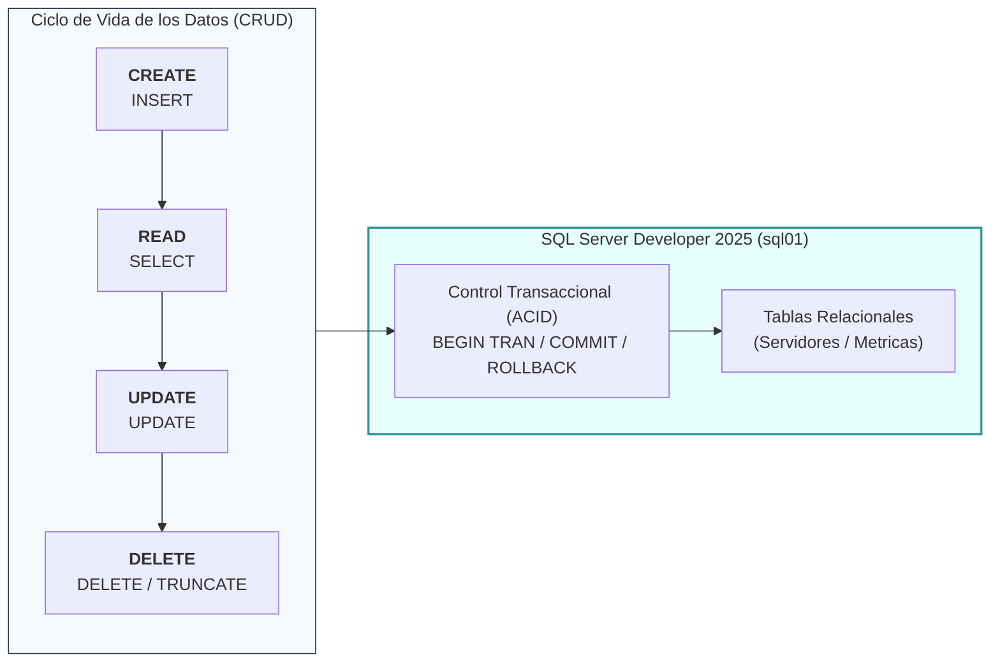

# Operaciones CRUD y Automatización con PowerShell

## 🎯 Relación con el Currículo (RA y CE)
El diseño de bases de datos operativas, la ejecución de operaciones de manipulación de datos (DML) y su automatización mediante scripts desde el sistema operativo dan soporte directo a los siguientes elementos del currículo oficial:

* **Resultado de Aprendizaje 6 (RA6) / 7 (RA7):** Utiliza lenguajes de guiones en sistemas operativos, describiendo su aplicación y administrando servicios del sistema operativo.
    * **CE4-RA7:** Se han desarrollado scripts para la captura, procesamiento y almacenamiento estructurado de información del sistema.
    * **CE5-RA7:** Se han probado guiones que interactúan con servicios de red corporativos (conexión automatizada a SQL Server).
* **Resultado de Aprendizaje 8 (RA8):** Gestiona servidores de bases de datos integrados en el sistema operativo asegurando la disponibilidad e integridad de los datos.
    * **CE2-RA8:** Se han creado bases de datos y estructuras de tablas definiendo tipos de datos, claves e integridad referencial.
    * **CE4-RA8:** Se han ejecutado operaciones de consulta, inserción, actualización y eliminación de registros (operaciones CRUD).
    * **CE7-RA8:** Se han implementado transacciones garantizando las propiedades ACID y la coherencia de la información.

---

## 🏢 1. Introducción al Ciclo de Vida CRUD

En el contexto de la administración de sistemas e infraestructuras, el acrónimo **CRUD** describe las cuatro operaciones elementales que cualquier servicio, script de supervisión o aplicación ejecuta sobre un sistema gestor de bases de datos relacionales:

| Operación | Significado | Instrucción T-SQL | Propósito en Administración de Sistemas |
| :--- | :--- | :--- | :--- |
| **C** | **Create** | `INSERT` | Registro de nuevos servidores en el inventario o almacenamiento de métricas de rendimiento. |
| **R** | **Read** | `SELECT` | Consulta del estado de salud de la infraestructura, auditoría y lectura de alertas activas. |
| **U** | **Update** | `UPDATE` | Modificación del estado operativo de una máquina (ej: poner un nodo en mantenimiento). |
| **D** | **Delete** | `DELETE` / `TRUNCATE` | Depuración y purgado programado de históricos antiguos o retirada de recursos dados de baja. |



---

## 🏗️ 2. Preparación del Laboratorio: Esquema de Base de Datos

Para ilustrar estas operaciones sobre un escenario técnico representativo del módulo de **ASO**, crearemos la base de datos **`MonitorizacionASO`** con dos tablas relacionadas destinadas a inventariar servidores y registrar telemetría de rendimiento.

Abre una ventana de consulta (**New Query**) en SSMS o conéctate con `sqlcmd`:

```sql
-- 1. Creación de la Base de Datos con dimensionamiento inicial
CREATE DATABASE [MonitorizacionASO]
ON PRIMARY 
(
    NAME = N'MonitorizacionASO_Data',
    FILENAME = N'C:\Program Files\Microsoft SQL Server\MSSQL17.MSSQLSERVER\MSSQL\DATA\MonitorizacionASO.mdf',
    SIZE = 100MB,
    MAXSIZE = UNLIMITED,
    FILEGROWTH = 64MB
)
LOG ON 
(
    NAME = N'MonitorizacionASO_Log',
    FILENAME = N'C:\Program Files\Microsoft SQL Server\MSSQL17.MSSQLSERVER\MSSQL\DATA\MonitorizacionASO_Log.ldf',
    SIZE = 50MB,
    MAXSIZE = 2GB,
    FILEGROWTH = 32MB
);
GO
```

!!! tip "Rutas físicas según la versión del motor"
    En **SQL Server 2025**, la carpeta de la instancia predeterminada es `MSSQL17.MSSQLSERVER`. Si en algún equipo o laboratorio auxiliar se utiliza **SQL Server 2022**, la ruta correspondiente sería `MSSQL16.MSSQLSERVER`.

```sql
USE [MonitorizacionASO];
GO

-- 2. Tabla de Inventario de Servidores
CREATE TABLE [dbo].[Servidores] (
    [IdServidor]        INT IDENTITY(1,1) NOT NULL,
    [NombreHost]        VARCHAR(50)       NOT NULL,
    [DireccionIP]       VARCHAR(15)       NOT NULL,
    [SistemaOperativo]  VARCHAR(100)      NOT NULL,
    [RolServidor]       VARCHAR(50)       NOT NULL,
    [EnMantenimiento]   BIT               NOT NULL CONSTRAINT [DF_Servidores_Mantenimiento] DEFAULT (0),
    [FechaAlta]         DATETIME2(0)      NOT NULL CONSTRAINT [DF_Servidores_FechaAlta] DEFAULT (SYSDATETIME()),
    
    CONSTRAINT [PK_Servidores] PRIMARY KEY CLUSTERED ([IdServidor] ASC),
    CONSTRAINT [UQ_Servidores_Host] UNIQUE ([NombreHost]),
    CONSTRAINT [CK_Servidores_IP] CHECK ([DireccionIP] LIKE '%.%.%.%')
);
GO

-- 3. Tabla de Métricas de Supervisión
CREATE TABLE [dbo].[MetricasRendimiento] (
    [IdMetrica]         BIGINT IDENTITY(1,1) NOT NULL,
    [IdServidor]        INT                  NOT NULL,
    [FechaCaptura]      DATETIME2(0)         NOT NULL CONSTRAINT [DF_Metricas_Fecha] DEFAULT (SYSDATETIME()),
    [UsoCpuPct]         DECIMAL(5,2)         NOT NULL,
    [MemoriaLibreMB]    INT                  NOT NULL,
    [EspacioDiscoLibreGB] DECIMAL(7,2)       NOT NULL,
    [NivelAlerta]       VARCHAR(10)          NOT NULL CONSTRAINT [DF_Metricas_Alerta] DEFAULT ('NORMAL'),

    CONSTRAINT [PK_MetricasRendimiento] PRIMARY KEY CLUSTERED ([IdMetrica] ASC),
    CONSTRAINT [FK_Metricas_Servidores] FOREIGN KEY ([IdServidor]) 
        REFERENCES [dbo].[Servidores] ([IdServidor]) ON DELETE CASCADE,
    CONSTRAINT [CK_Metricas_CPU] CHECK ([UsoCpuPct] BETWEEN 0.00 AND 100.00),
    CONSTRAINT [CK_Metricas_Alerta] CHECK ([NivelAlerta] IN ('NORMAL', 'WARNING', 'CRITICAL'))
);
GO
```

---

## 📝 3. Operaciones CRUD mediante T-SQL

### 3.1. Operación CREATE (`INSERT`)

La instrucción `INSERT` permite agregar nuevas filas a una tabla.

#### Inserción de un registro individual
```sql
USE [MonitorizacionASO];
GO

INSERT INTO [dbo].[Servidores] ([NombreHost], [DireccionIP], [SistemaOperativo], [RolServidor])
VALUES ('DC01', '192.168.10.100', 'Windows Server 2025 Standard', 'Domain Controller');
```

#### Inserción por lotes (*Multi-row insert*)
Podemos registrar múltiples entidades en una única transacción de red:

```sql
INSERT INTO [dbo].[Servidores] ([NombreHost], [DireccionIP], [SistemaOperativo], [RolServidor], [EnMantenimiento])
VALUES 
    ('sql01', '192.168.10.101', 'Windows Server 2025 Standard', 'Database Server', 0),
    ('web01', '192.168.10.102', 'Ubuntu Server 24.04 LTS',     'Web Frontend',    0),
    ('bkp01', '192.168.10.103', 'Debian 12 Bookworm',          'Backup Server',   1);
```

#### Inserción con captura del ID autoincremental (`SCOPE_IDENTITY`)
Cuando insertamos métricas dependientes de una clave foránea:

```sql
-- Obtener el ID del servidor 'sql01' e insertar una captura de métricas
DECLARE @SrvId INT;
SELECT @SrvId = [IdServidor] FROM [dbo].[Servidores] WHERE [NombreHost] = 'sql01';

INSERT INTO [dbo].[MetricasRendimiento] ([IdServidor], [UsoCpuPct], [MemoriaLibreMB], [EspacioDiscoLibreGB], [NivelAlerta])
VALUES (@SrvId, 45.50, 2048, 48.20, 'NORMAL');

-- Obtener el identificador autogenerado de la métrica recién insertada
SELECT SCOPE_IDENTITY() AS [UltimaMetricaId];
```

---

### 3.2. Operación READ (`SELECT`)

La instrucción `SELECT` extrae información persistida según criterios de filtrado, ordenación y agrupamiento.

#### Consultas con filtrado y operadores lógicos
```sql
-- Consultar servidores operativos que no estén en mantenimiento
SELECT [IdServidor], [NombreHost], [DireccionIP], [RolServidor]
FROM [dbo].[Servidores]
WHERE [EnMantenimiento] = 0
ORDER BY [NombreHost] ASC;
```

#### Cruce relacional de tablas (`INNER JOIN`)
Consolidar el nombre del host junto con su telemetría registrada:

```sql
SELECT 
    S.[NombreHost],
    S.[RolServidor],
    M.[FechaCaptura],
    M.[UsoCpuPct],
    M.[MemoriaLibreMB],
    M.[NivelAlerta]
FROM [dbo].[Servidores] S
INNER JOIN [dbo].[MetricasRendimiento] M ON S.[IdServidor] = M.[IdServidor]
WHERE M.[UsoCpuPct] > 80.00 OR M.[NivelAlerta] = 'CRITICAL'
ORDER BY M.[FechaCaptura] DESC;
```

#### Agrupación y cálculo estadístico (`GROUP BY`)
Determinar el uso medio de CPU y el mínimo de memoria libre por cada servidor:

```sql
SELECT 
    S.[NombreHost],
    COUNT(M.[IdMetrica]) AS [TotalMuestras],
    AVG(M.[UsoCpuPct])    AS [CpuMediaPct],
    MIN(M.[MemoriaLibreMB]) AS [MemoriaMinimaMB]
FROM [dbo].[Servidores] S
LEFT JOIN [dbo].[MetricasRendimiento] M ON S.[IdServidor] = M.[IdServidor]
GROUP BY S.[NombreHost]
HAVING COUNT(M.[IdMetrica]) > 0;
```

---

### 3.3. Operación UPDATE (`UPDATE`)

La instrucción `UPDATE` modifica valores en filas ya existentes en disco.

!!! danger "Precaución con el filtro WHERE"
    Un `UPDATE` sin cláusula `WHERE` actualizará **absolutamente todas las filas de la tabla**, corrompiendo la coherencia de los datos. Como buena práctica de administración, ejecuta siempre previamente un `SELECT` con la misma condición `WHERE` para validar qué registros serán afectados.

#### Modificar el estado operativo de un nodo
```sql
-- Poner el servidor 'web01' en modo mantenimiento
UPDATE [dbo].[Servidores]
SET [EnMantenimiento] = 1
WHERE [NombreHost] = 'web01';
```

#### Actualización basada en cálculos o auditoría
Modificar el nivel de alerta si la CPU supera el umbral crítico:

```sql
UPDATE [dbo].[MetricasRendimiento]
SET [NivelAlerta] = 'CRITICAL'
WHERE [UsoCpuPct] >= 90.00 AND [NivelAlerta] <> 'CRITICAL';
```

#### Auditoría de cambios con la cláusula `OUTPUT`
SQL Server permite capturar en una sola operación el valor antes (`DELETED`) y después (`INSERTED`) de la modificación:

```sql
UPDATE [dbo].[Servidores]
SET [DireccionIP] = '192.168.10.222'
OUTPUT 
    DELETED.[NombreHost],
    DELETED.[DireccionIP] AS [IP_Anterior],
    INSERTED.[DireccionIP] AS [IP_Nueva]
WHERE [NombreHost] = 'bkp01';
```

---

### 3.4. Operación DELETE (`DELETE` vs `TRUNCATE`)

#### Eliminación condicional con `DELETE`
Borra filas específicas conservando la estructura de la tabla y la secuencia de autoincrementales:

```sql
-- Eliminar las métricas registradas con más de 30 días de antigüedad
DELETE FROM [dbo].[MetricasRendimiento]
WHERE [FechaCaptura] < DATEADD(DAY, -30, SYSDATETIME());
```

#### Comparativa Técnica: `DELETE` vs `TRUNCATE TABLE`

| Característica | `DELETE FROM Tabla` | `TRUNCATE TABLE Tabla` |
| :--- | :--- | :--- |
| **Tipo de instrucción** | DML (*Data Manipulation Language*) | DDL (*Data Definition Language*) |
| **Filtrado (`WHERE`)** | Permite eliminar filas selectivas con `WHERE`. | **No admite `WHERE`**. Vacía la tabla por completo. |
| **Mecanismo de log** | Registra cada fila borrada individualmente en el `.ldf`. Operación lenta para millones de registros. | Deasigna las páginas completas de 8 KB. Mucho más rápido y eficiente en el uso del log. |
| **Contador `IDENTITY`** | Conserva el valor actual del contador autoincremental. | **Resetea** el contador `IDENTITY` a su valor semilla inicial (ej: `1`). |
| **Claves Foráneas** | Funciona si se cumplen las restricciones o mediante borrado en cascada. | **Falla** si la tabla está referenciada por una restricción `FOREIGN KEY`, incluso si la tabla hija está vacía. |

```sql
-- Vaciado ultrarrápido de una tabla de pruebas sin dependencias foráneas
TRUNCATE TABLE [dbo].[MetricasHistoricasTemp];
```

---

## 🔒 4. Control Transaccional (Garantía ACID)

En administración de sistemas, muchas operaciones implican múltiples pasos que deben completarse en su totalidad o revertirse íntegramente ante cualquier fallo (*Atomicidad*).

Utilizamos bloques `BEGIN TRANSACTION`, `COMMIT` y `ROLLBACK` combinados con control estructurado de excepciones `TRY ... CATCH`:

```sql
BEGIN TRY
    BEGIN TRANSACTION;

    -- Paso 1: Insertar un nuevo servidor
    INSERT INTO [dbo].[Servidores] ([NombreHost], [DireccionIP], [SistemaOperativo], [RolServidor])
    VALUES ('db02', '192.168.10.104', 'Windows Server 2025', 'Database Replica');

    DECLARE @NuevoId INT = SCOPE_IDENTITY();

    -- Paso 2: Registrar su primera métrica inicial
    INSERT INTO [dbo].[MetricasRendimiento] ([IdServidor], [UsoCpuPct], [MemoriaLibreMB], [EspacioDiscoLibreGB])
    VALUES (@NuevoId, 12.00, 4096, 120.50);

    -- Si ambas sentencias han tenido éxito, confirmamos los cambios definitivamente
    COMMIT TRANSACTION;
    PRINT 'Transacción confirmada con éxito (COMMIT).';
END TRY
BEGIN CATCH
    -- Si se produce cualquier error, cancelamos todos los cambios realizados
    IF @@TRANCOUNT > 0
        ROLLBACK TRANSACTION;

    PRINT 'Error detectado. Transacción revertida (ROLLBACK): ' + ERROR_MESSAGE();
END CATCH;
GO
```

---

## ⚡ 5. Automatización de CRUD desde PowerShell

En el entorno de **2º ASIR**, el administrador rara vez escribe sentencias T-SQL a mano de manera recurrente; en su lugar, implementa **scripts en PowerShell** que interactúan con SQL Server de forma desatendida.

### Método A: Utilizando el Módulo `SqlServer` (`Invoke-Sqlcmd`)

Si el equipo cuenta con el módulo oficial `SqlServer`, `Invoke-Sqlcmd` simplifica la ejecución directa de consultas:

```powershell
# Instalar el módulo oficial si no está presente
if (-not (Get-Module -ListAvailable -Name SqlServer)) {
    Install-Module -Name SqlServer -Scope CurrentUser -Force
}

# Parámetros de conexión a la VM en Proxmox
$servidor = "192.168.10.101"
$bd       = "MonitorizacionASO"
$usuario  = "app_monitor"
$password = "PasswordSeguraApp2026!"

# 1. CREATE: Inserción de una métrica
$insertQuery = @"
INSERT INTO [dbo].[MetricasRendimiento] ([IdServidor], [UsoCpuPct], [MemoriaLibreMB], [EspacioDiscoLibreGB])
VALUES (1, 62.40, 1530, 45.10);
"@

Invoke-Sqlcmd -ServerInstance $servidor -Database $bd -Username $usuario -Password $password -Query $insertQuery -TrustServerCertificate

# 2. READ: Lectura de las últimas alertas críticas
$selectQuery = @"
SELECT TOP 5 S.[NombreHost], M.[FechaCaptura], M.[UsoCpuPct], M.[NivelAlerta]
FROM [dbo].[Servidores] S
INNER JOIN [dbo].[MetricasRendimiento] M ON S.[IdServidor] = M.[IdServidor]
ORDER BY M.[FechaCaptura] DESC;
"@

$resultados = Invoke-Sqlcmd -ServerInstance $servidor -Database $bd -Username $usuario -Password $password -Query $selectQuery -TrustServerCertificate
$resultados | Format-Table -AutoSize
```

---

### Método B: Conexión Portable Nativa .NET (`System.Data.SqlClient`)

Este método **no requiere instalar ningún módulo externo**, por lo que es 100% portable y compatible con cualquier instalación limpia de Windows Server o PowerShell:

```powershell
# Script autónomo: Recolección y registro CRUD en SQL Server
$servidor = "192.168.10.101"
$bd       = "MonitorizacionASO"
$usuario  = "app_monitor"
$password = "PasswordSeguraApp2026!"

# Cadena de conexión estandarizada
$connectionString = "Server=$servidor;Database=$bd;User Id=$usuario;Password=$password;TrustServerCertificate=True;Timeout=15;"

# Obtener métricas reales de la máquina local
$cpuCounter = Get-Counter '\Processor(_Total)\% Processor Time' -ErrorAction SilentlyContinue
$cpuUsage   = [math]::Round($cpuCounter.CounterSamples[0].CookedValue, 2)
$osInfo     = Get-CimInstance Win32_OperatingSystem
$freeRamMB  = [math]::Round($osInfo.FreePhysicalMemory / 1024, 0)
$diskInfo   = Get-CimInstance Win32_LogicalDisk -Filter "DeviceID='C:'"
$freeDiskGB = [math]::Round($diskInfo.FreeSpace / 1GB, 2)

# Determinar nivel de alerta
$alerta = if ($cpuUsage -gt 85) { 'CRITICAL' } elseif ($cpuUsage -gt 70) { 'WARNING' } else { 'NORMAL' }

# Conectar e insertar mediante objetos ADO.NET nativos
$connection = New-Object System.Data.SqlClient.SqlConnection($connectionString)
try {
    $connection.Open()
    
    # Consulta parametrizada para máxima seguridad contra inyecciones SQL
    $sqlCmd = $connection.CreateCommand()
    $sqlCmd.CommandText = @"
        INSERT INTO [dbo].[MetricasRendimiento] 
        ([IdServidor], [UsoCpuPct], [MemoriaLibreMB], [EspacioDiscoLibreGB], [NivelAlerta])
        VALUES (@IdServidor, @Cpu, @Ram, @Disco, @Alerta);
"@
    
    # Asignación de parámetros tipados
    $sqlCmd.Parameters.AddWithValue("@IdServidor", 1) | Out-Null
    $sqlCmd.Parameters.AddWithValue("@Cpu", $cpuUsage) | Out-Null
    $sqlCmd.Parameters.AddWithValue("@Ram", $freeRamMB) | Out-Null
    $sqlCmd.Parameters.AddWithValue("@Disco", $freeDiskGB) | Out-Null
    $sqlCmd.Parameters.AddWithValue("@Alerta", $alerta) | Out-Null

    $filasAfectadas = $sqlCmd.ExecuteNonQuery()
    Write-Host "[OK] Métrica insertada con éxito ($filasAfectadas fila). CPU: $cpuUsage% | RAM Libre: $freeRamMB MB" -ForegroundColor Green
}
catch {
    Write-Error "Fallo en la operación CRUD contra SQL Server: $_"
}
finally {
    if ($connection.State -eq [System.Data.ConnectionState]::Open) {
        $connection.Close()
        $connection.Dispose()
    }
}
```

---

## 🏆 Resumen de Buenas Prácticas del Administrador

1. **Uso de Consultas Parametrizadas:** Nunca concatenes cadenas de texto directamente dentro de una sentencia SQL en PowerShell; utiliza parámetros para evitar ataques de inyección SQL y mejorar el rendimiento del plan de ejecución en el servidor.
2. **Consultas no bloqueantes:** En bases de datos de alta concurrencia, evita lanzar `SELECT *` masivos sobre tablas transaccionales de millones de registros durante horas punta.
3. **Control de Crecimiento del Log (`.ldf`):** Las operaciones de borrado masivo con `DELETE` pueden inflar el archivo de transacciones hasta agotar el espacio en disco de la VM en Proxmox. Para purgas totales de tablas de staging, utiliza `TRUNCATE TABLE`.
4. **Cierre de Conexiones:** En scripts automatizados o tareas programadas de Windows, asegura siempre el cierre de la conexión (`Close()` / `Dispose()`) dentro de bloques `finally` para evitar agotar el cupo de conexiones abiertas en el motor.

---

## 📚 Referencias

!!! info "Documentación oficial"
    * **Microsoft Learn — Manipulación de datos (DML) en Transact-SQL (INSERT, UPDATE, DELETE):** [https://learn.microsoft.com/es-es/sql/t-sql/statements/insert-transact-sql](https://learn.microsoft.com/es-es/sql/t-sql/statements/insert-transact-sql)
    * **Microsoft Learn — Consultas de datos mediante SELECT (Transact-SQL):** [https://learn.microsoft.com/es-es/sql/t-sql/queries/select-transact-sql](https://learn.microsoft.com/es-es/sql/t-sql/queries/select-transact-sql)
    * **Sentencia TRUNCATE TABLE frente a DELETE masivo:** [https://learn.microsoft.com/es-es/sql/t-sql/statements/truncate-table-transact-sql](https://learn.microsoft.com/es-es/sql/t-sql/statements/truncate-table-transact-sql)
    * **Control de transacciones (Transact-SQL) y propiedades ACID:** [https://learn.microsoft.com/es-es/sql/t-sql/language-elements/transactions-transact-sql](https://learn.microsoft.com/es-es/sql/t-sql/language-elements/transactions-transact-sql)
    * **Referencia del cmdlet `Invoke-Sqlcmd` (Módulo SqlServer):** [https://learn.microsoft.com/es-es/powershell/module/sqlserver/invoke-sqlcmd](https://learn.microsoft.com/es-es/powershell/module/sqlserver/invoke-sqlcmd)
    * **Clases y comandos de ADO.NET en .NET / PowerShell (`System.Data.SqlClient`):** [https://learn.microsoft.com/es-es/dotnet/api/system.data.sqlclient](https://learn.microsoft.com/es-es/dotnet/api/system.data.sqlclient)
    * **Consultas parametrizadas y prevención de inyección SQL:** [https://learn.microsoft.com/es-es/dotnet/framework/data/adonet/commands-and-parameters](https://learn.microsoft.com/es-es/dotnet/framework/data/adonet/commands-and-parameters)

!!! info "Autoría y contexto educativo"
    * **Docente y elaboración didáctica:** José Ramón Soria Nieto, Departamento de Informática del **IES Marcos Zaragoza**.
    * Material elaborado para el módulo **Administración de Sistemas Operativos** del ciclo de **Administración de Sistemas Informáticos en Red**.
    * Contenido estructurado con apoyo de inteligencia artificial generativa y revisado tomando como referencia la documentación oficial de Microsoft.

!!! abstract "Soporte Institucional y Fondo Social Europeo"
    * **Órgano Regulador:** Generalitat Valenciana — Conselleria d'Educació, Cultura i Esport.
    * **Acreditación de Financiación:** Proyecto tecnológico cofinanciado por la **Unión Europea** a través del **Fondo Social Europeo (FSE)**.
    * *«El FSE invierte en tu futuro»* — Acciones destinadas a la digitalización avanzada, el despliegue de infraestructuras críticas en las aulas y la formación técnica especializada para entornos laborales de Formación Profesional.
